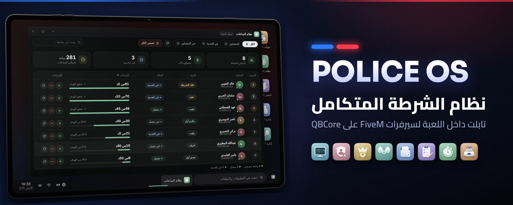

# Police OS

**Police OS** نظام شرطة متكامل لسيرفرات **FiveM** المبنية على **QBCore**. يحصل كل ضابط على **تابلت داخل اللعبة** يسجّل الدخول إليه بحساب خاص، ثم يفتح من سطح مكتبه **8 تطبيقات**: الموكب، الساعات، اختبار الشرطة، إدارة الاختبار، الأجنحة، الإدارة، الحسابات، ونظام العمليات (MDT).

<a href="getting-started/installation.md" class="button primary" data-icon="rocket">ابدأ التركيب</a> <a href="usage/tablet.md" class="button secondary" data-icon="book-open">تعرّف على التابلت</a>

الإصدار **3.3** · QBCore · Lua 5.4 · العربية والإنجليزية · اسم المورد في الأمثلة: `police-os`

## البدء السريع

من التجهيز إلى أول تسجيل دخول.

<table data-view="cards">
  <thead>
    <tr>
      <th></th>
      <th></th>
      <th data-hidden data-card-target data-type="content-ref"></th>
      <th data-hidden data-card-cover data-type="files"></th>
    </tr>
  </thead>
  <tbody>
    <tr>
      <td><strong>المتطلبات</strong></td>
      <td>ما يلزم تثبيته على السيرفر قبل البدء</td>
      <td><a href="getting-started/requirements.md">requirements.md</a></td>
      <td><a href=".gitbook/assets/card-requirements.jpg">card-requirements.jpg</a></td>
    </tr>
    <tr>
      <td><strong>التركيب</strong></td>
      <td>وضع المورد وآيتم التابلت وإعداد server.cfg وتشغيله</td>
      <td><a href="getting-started/installation.md">installation.md</a></td>
      <td><a href=".gitbook/assets/card-installation.jpg">card-installation.jpg</a></td>
    </tr>
    <tr>
      <td><strong>أول تشغيل</strong></td>
      <td>إنشاء أول حساب وتسجيل الدخول إلى التابلت</td>
      <td><a href="getting-started/first-run.md">first-run.md</a></td>
      <td><a href=".gitbook/assets/card-first-run.jpg">card-first-run.jpg</a></td>
    </tr>
  </tbody>
</table>

## دليل الاستخدام

كل تطبيق في التابلت وما يفعله.

### للضباط

<table data-view="cards">
  <thead>
    <tr>
      <th></th>
      <th></th>
      <th data-hidden data-card-target data-type="content-ref"></th>
      <th data-hidden data-card-cover data-type="files"></th>
    </tr>
  </thead>
  <tbody>
    <tr>
      <td><strong>التابلت وسطح المكتب</strong></td>
      <td>الفتح وشاشة الدخول والنوافذ وقائمة ابدأ</td>
      <td><a href="usage/tablet.md">tablet.md</a></td>
      <td><a href=".gitbook/assets/card-tablet.jpg">card-tablet.jpg</a></td>
    </tr>
    <tr>
      <td><strong>موكب الشرطة</strong></td>
      <td>تجهيز موكب حتى 8 مركبات وإخراجه بضغطة</td>
      <td><a href="usage/convoy.md">convoy.md</a></td>
      <td><a href=".gitbook/assets/card-convoy.jpg">card-convoy.jpg</a></td>
    </tr>
    <tr>
      <td><strong>نظام الساعات</strong></td>
      <td>احتساب ساعات الخدمة وإدارتها</td>
      <td><a href="usage/hours.md">hours.md</a></td>
      <td><a href=".gitbook/assets/card-hours.jpg">card-hours.jpg</a></td>
    </tr>
    <tr>
      <td><strong>النظام العسكري (MDT)</strong></td>
      <td>المواطنون والمركبات والتقارير والقضايا</td>
      <td><a href="usage/mdt.md">mdt.md</a></td>
      <td><a href=".gitbook/assets/card-mdt.jpg">card-mdt.jpg</a></td>
    </tr>
    <tr>
      <td><strong>الطبيب وبوت الأجنحة</strong></td>
      <td>علاج المصابين وإخراج مركبات الأجنحة</td>
      <td><a href="usage/npcs.md">npcs.md</a></td>
      <td><a href=".gitbook/assets/card-npcs.jpg">card-npcs.jpg</a></td>
    </tr>
  </tbody>
</table>

### للمدرّبين والإدارة

<table data-view="cards">
  <thead>
    <tr>
      <th></th>
      <th></th>
      <th data-hidden data-card-target data-type="content-ref"></th>
      <th data-hidden data-card-cover data-type="files"></th>
    </tr>
  </thead>
  <tbody>
    <tr>
      <td><strong>اختبار الشرطة</strong></td>
      <td>اختبار القبول للمتدرب وتسجيل نتيجته</td>
      <td><a href="usage/police-test.md">police-test.md</a></td>
      <td><a href=".gitbook/assets/card-police-test.jpg">card-police-test.jpg</a></td>
    </tr>
    <tr>
      <td><strong>إدارة الاختبار</strong></td>
      <td>أسئلة الاختبار والمدرّبون والنتائج</td>
      <td><a href="usage/test-management.md">test-management.md</a></td>
      <td><a href=".gitbook/assets/card-test-management.jpg">card-test-management.jpg</a></td>
    </tr>
    <tr>
      <td><strong>إدارة الأجنحة</strong></td>
      <td>أعضاء الأجنحة ومسؤولوها</td>
      <td><a href="usage/wings.md">wings.md</a></td>
      <td><a href=".gitbook/assets/card-wings.jpg">card-wings.jpg</a></td>
    </tr>
    <tr>
      <td><strong>إدارة الشرطة (البوس)</strong></td>
      <td>التوظيف والفصل والترقية وإنشاء الأجنحة</td>
      <td><a href="usage/boss.md">boss.md</a></td>
      <td><a href=".gitbook/assets/card-boss.jpg">card-boss.jpg</a></td>
    </tr>
    <tr>
      <td><strong>إدارة الحسابات والصلاحيات</strong></td>
      <td>حسابات الدخول وصلاحياتها</td>
      <td><a href="usage/accounts.md">accounts.md</a></td>
      <td><a href=".gitbook/assets/card-accounts.jpg">card-accounts.jpg</a></td>
    </tr>
  </tbody>
</table>

## الإعدادات

اضبط السكربت على سيرفرك.

<table data-view="cards">
  <thead>
    <tr>
      <th></th>
      <th></th>
      <th data-hidden data-card-target data-type="content-ref"></th>
      <th data-hidden data-card-cover data-type="files"></th>
    </tr>
  </thead>
  <tbody>
    <tr>
      <td><strong>مرجع config.lua</strong></td>
      <td>كل الإعدادات وقيمها الافتراضية</td>
      <td><a href="configuration/config-reference.md">config-reference.md</a></td>
      <td><a href=".gitbook/assets/card-config-reference.jpg">card-config-reference.jpg</a></td>
    </tr>
    <tr>
      <td><strong>الرتب والوظائف</strong></td>
      <td>ربط السكربت برتب وظيفتك ووظائف الشرطة الإضافية</td>
      <td><a href="configuration/ranks-and-jobs.md">ranks-and-jobs.md</a></td>
      <td><a href=".gitbook/assets/card-ranks-and-jobs.jpg">card-ranks-and-jobs.jpg</a></td>
    </tr>
    <tr>
      <td><strong>الصلاحيات</strong></td>
      <td>الصلاحيات الثلاثون وما يؤثر منها فعليًا</td>
      <td><a href="configuration/permissions.md">permissions.md</a></td>
      <td><a href=".gitbook/assets/card-permissions.jpg">card-permissions.jpg</a></td>
    </tr>
    <tr>
      <td><strong>اللغات</strong></td>
      <td>تبديل اللغة وإضافة لغة جديدة بملف واحد</td>
      <td><a href="configuration/languages.md">languages.md</a></td>
      <td><a href=".gitbook/assets/card-languages.jpg">card-languages.jpg</a></td>
    </tr>
    <tr>
      <td><strong>المظهر والأيقونات</strong></td>
      <td>اسم السيرفر والأيقونات والخلفية وحجم الجهاز</td>
      <td><a href="configuration/appearance.md">appearance.md</a></td>
      <td><a href=".gitbook/assets/card-appearance.jpg">card-appearance.jpg</a></td>
    </tr>
  </tbody>
</table>

## الإدارة

أوامر وإشعارات وواجهة برمجية وقاعدة بيانات وأمان.

<table data-view="cards">
  <thead>
    <tr>
      <th></th>
      <th></th>
      <th data-hidden data-card-target data-type="content-ref"></th>
      <th data-hidden data-card-cover data-type="files"></th>
    </tr>
  </thead>
  <tbody>
    <tr>
      <td><strong>الأوامر</strong></td>
      <td>19 أمرًا للعبة والكونسول</td>
      <td><a href="admin/commands.md">commands.md</a></td>
      <td><a href=".gitbook/assets/card-commands.jpg">card-commands.jpg</a></td>
    </tr>
    <tr>
      <td><strong>ديسكورد والويبهوك</strong></td>
      <td>روابط الإشعارات وحفظ أسرارها</td>
      <td><a href="configuration/discord.md">discord.md</a></td>
      <td><a href=".gitbook/assets/card-discord.jpg">card-discord.jpg</a></td>
    </tr>
    <tr>
      <td><strong>واجهة HTTP API</strong></td>
      <td>إنشاء الحسابات والتحقق من الدخول من بوتك أو موقعك</td>
      <td><a href="admin/http-api.md">http-api.md</a></td>
      <td><a href=".gitbook/assets/card-http-api.jpg">card-http-api.jpg</a></td>
    </tr>
    <tr>
      <td><strong>قاعدة البيانات</strong></td>
      <td>الجداول والترقية التلقائية والصيانة</td>
      <td><a href="admin/database.md">database.md</a></td>
      <td><a href=".gitbook/assets/card-database.jpg">card-database.jpg</a></td>
    </tr>
    <tr>
      <td><strong>الأمان</strong></td>
      <td>حماية الحسابات والأسرار وحدودها</td>
      <td><a href="admin/security.md">security.md</a></td>
      <td><a href=".gitbook/assets/card-security.jpg">card-security.jpg</a></td>
    </tr>
  </tbody>
</table>

## الدعم

عند تعثّر شيء أو ترقية نسخة.

<table data-view="cards">
  <thead>
    <tr>
      <th></th>
      <th></th>
      <th data-hidden data-card-target data-type="content-ref"></th>
      <th data-hidden data-card-cover data-type="files"></th>
    </tr>
  </thead>
  <tbody>
    <tr>
      <td><strong>حل المشاكل</strong></td>
      <td>الأعراض الشائعة وحلولها</td>
      <td><a href="support/troubleshooting.md">troubleshooting.md</a></td>
      <td><a href=".gitbook/assets/card-troubleshooting.jpg">card-troubleshooting.jpg</a></td>
    </tr>
    <tr>
      <td><strong>الأسئلة الشائعة</strong></td>
      <td>إجابات سريعة عن أكثر الأسئلة</td>
      <td><a href="support/faq.md">faq.md</a></td>
      <td><a href=".gitbook/assets/card-faq.jpg">card-faq.jpg</a></td>
    </tr>
    <tr>
      <td><strong>سجل التغييرات</strong></td>
      <td>ما الجديد في كل إصدار</td>
      <td><a href="support/changelog.md">changelog.md</a></td>
      <td><a href=".gitbook/assets/card-changelog.jpg">card-changelog.jpg</a></td>
    </tr>
  </tbody>
</table>

---

للدعم المباشر تواصل مع البائع عبر القناة التي وصلتك عند الشراء.
