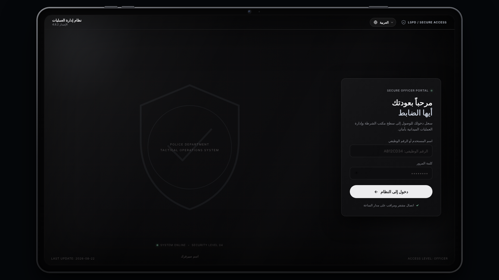
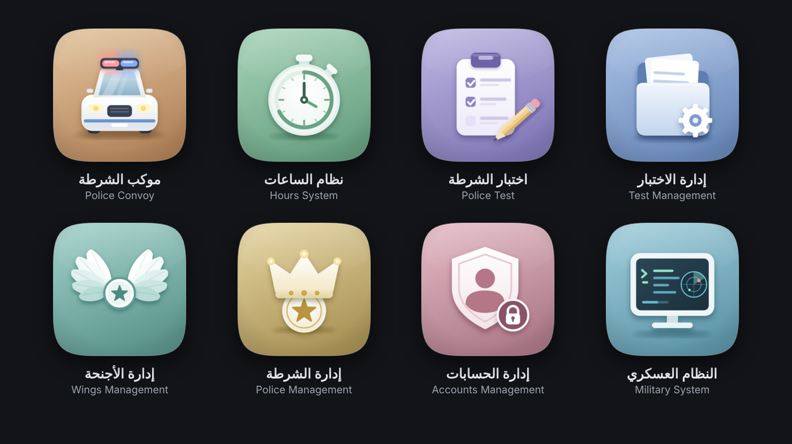
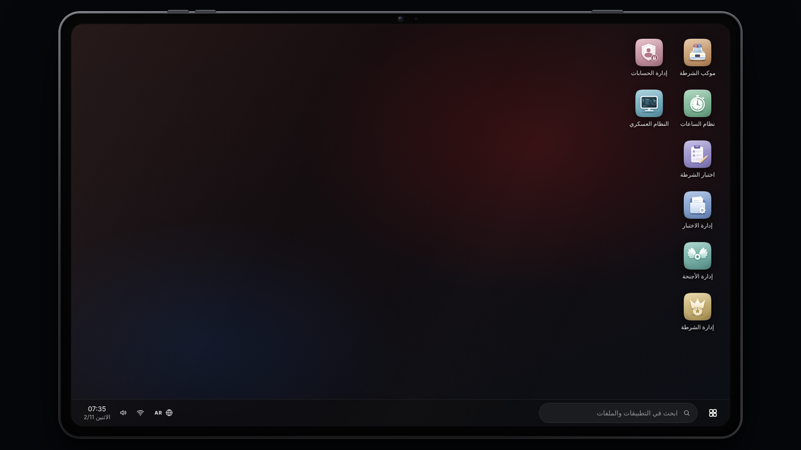
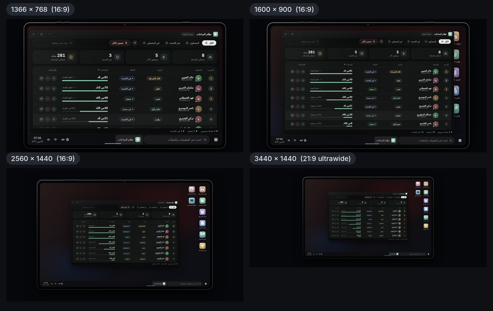

# المظهر والأيقونات

أغلب ما تحتاجه لجعل النظام باسمك وهويتك يكون من `config.lua` وبصور تضعها في مجلد الواجهة. وتعديلات الألوان وبعض النصوص الثابتة تتطلب تحرير ملفات `html/`.


إن كانت ملفات `html/` مقفلة أو محمية في نسختك فاطلب التعديلات المذكورة تحت «تعديلات على ملفات الواجهة» من البائع. أما ما يخص `config.lua` وصور الأيقونات والخلفية فمتاح دائمًا.


## اسم سيرفرك في شاشة الدخول


```lua
Config.ServerName = 'اسم سيرفرك'
```


يظهر الاسم أسفل شعار شاشة الدخول. القيمة الفارغة `''` تُبقي النص المكتوب في `html/index.html`.



## أيقونات التطبيقات

لكل تطبيق أيقونة صورة PNG بمقاس 256×256 وزوايا شفافة في `html/img/apps/<id>.png`:

| المعرّف `id` | التطبيق |
|---|---|
| `procession` | موكب الشرطة |
| `hours` | نظام الساعات |
| `test` | اختبار الشرطة |
| `testmgmt` | إدارة الاختبار |
| `wingmgmt` | إدارة الأجنحة |
| `boss` | إدارة الشرطة |
| `accounts` | إدارة الحسابات |
| `mdt` | النظام العسكري |



### استبدال أيقونة

**الطريقة الأسهل:** استبدل الصورة بصورة تحمل الاسم نفسه ونفس المقاس.

**أو صورة باسم مختلف:**

1. ضع الصورة في `html/img/` (يُنصح بمربعة بين 256 و512 بكسل، بخلفية شفافة أو زوايا مستديرة).
2. سجّلها في `config.lua`:


```lua
Config.AppIcons = {
    mdt  = 'img/my_mdt_icon.png',
    boss = 'img/my_boss_icon.png',
}
```


3. نفّذ `restart police-os`.

* المسار نسبي إلى مجلد `html/`، ولا يقبل إلا الأحرف الإنجليزية والأرقام و`_` و`-` و`.` و`/` (يحذف النظام أي حرف آخر).
* **صيغة PNG فقط**: المورد يبث الصور من `html/img/*.png` و`html/img/apps/*.png`، فصيغة أخرى (JPG أو SVG...) لن تصل إلى اللاعب ما لم تضف نمطها إلى `files` في `fxmanifest.lua`.
* إن تعذّر تحميل الصورة تعود الأيقونة تلقائيًا إلى رمز مرسوم داخل مربع ملوّن، فلا تظهر صورة مكسورة أبدًا.

## صورة خلفية سطح المكتب

الحزمة لا تتضمن الخلفية. ضع صورتك باسم `back.png` في `html/img/` فتظهر خلف الأيقونات. تُعرض بنمط `cover` أي تُقصّ لتملأ الشاشة، ويُنصح بصورة بنسبة 16:10 (مثل 1920×1200). بدونها تظهر خلفية داكنة سادة والباقي يعمل كالمعتاد.



## حجم الجهاز

التابلت يتكيّف تلقائيًا مع دقة شاشة اللاعب. يُحسب عرضه كأصغر قيمة من: 96.5٪ من عرض الشاشة، وارتفاع الشاشة × 95٪ × 1.6 (نسبة 16:10)، و1900 بكسل.



## تعديلات على ملفات الواجهة

### لون جسم التابلت

الجهاز مرسوم كله بـ CSS (بلا صور). غيّر المتغيرات الأربعة في أول القسم `5d` من `html/apps.css`:


```css
:root{
  --dv-metal-hi:#4a4d55;   /* أعلى الجسم (يلتقط الضوء) */
  --dv-metal-mid:#2e3035;
  --dv-metal-lo:#1b1c1f;   /* أسفل الجسم */
  --dv-glass:#040405;      /* زجاج البيزل */
}
```


| اللون | `--dv-metal-hi` | `--dv-metal-mid` | `--dv-metal-lo` | `--dv-glass` |
|---|---|---|---|---|
| رمادي فحمي (الافتراضي) | `#4a4d55` | `#2e3035` | `#1b1c1f` | `#040405` |
| فضي | `#d6d9df` | `#aeb2ba` | `#7b7f88` | `#050506` |
| ذهبي | `#e3cfa3` | `#b9a173` | `#7d6a43` | `#050505` |
| أسود | `#2a2a2c` | `#171718` | `#0b0b0c` | `#000000` |

### لون كل تطبيق

في `html/apps.css` سطر لكل نافذة بالشكل `#win-<id>{--app:...; --app2:...}`، حيث `--app` لون التمييز الرئيسي (زر ونافذة) و`--app2` درجته الفاتحة. إن غيّرت `--app` فعدّل معه القيم `--soft` و`--soft2` (ظلال شفافة من اللون نفسه) و`--on-app` (لون النص فوقه) ليبقى التناسق.

| التطبيق | `--app` الافتراضي |
|---|---|
| `#win-procession` | `#c99f74` |
| `#win-hours` | `#86b99b` |
| `#win-test` | `#a39acd` |
| `#win-testmgmt` | `#86a3cf` |
| `#win-wingmgmt` | `#7db6ae` |
| `#win-boss` | `#c9b27a` |
| `#win-accounts` | `#c99aa7` |
| `#win-mdt` | `#7db3c4` |

### نسبة الجهاز وأقصى عرض

في الدالة `fitDevice()` داخل `html/script.js`: المتغير `DEV_RATIO` (الافتراضي `1.6`) هو نسبة العرض إلى الارتفاع، والرقم `1900` هو أقصى عرض بالبكسل.

### نصوص شاشة الدخول الثابتة

بعض نصوص شاشة الدخول مكتوبة ثابتة في `html/index.html`:

| النص | الموضع |
|---|---|
| `ACCESS LEVEL: OFFICER` و`LAST UPDATE: 2026-08-22` | نصان صغيران في ركنين من الشاشة |
| `LSPD / SECURE ACCESS` | شريط رأس الشاشة |
| «نظام إدارة العمليات» و«الإصدار 4.8.2» | شريط رأس الشاشة |
| `POLICE DEPARTMENT` و`TACTICAL OPERATIONS SYSTEM` | بجانب الشعار |
| `SYSTEM ONLINE` و`SECURITY LEVEL 04` | تحت الشعار |
| `SECURE OFFICER PORTAL` | أعلى بطاقة الدخول |
| `TLeader` | مثال يظهر داخل خانة الرقم الوظيفي |

عدّل ما تريده في الملف نفسه (مثلًا استبدل `LSPD` باسم إدارتك). النصوص العربية منها تُترجَم عبر ملفات اللغات، أما الإنجليزية فتبقى كما كتبتها.

## الخطوط

تحمّل الواجهة الخطين Cairo وTajawal من Google Fonts. إن لم يتوفر اتصال بالإنترنت على جهاز اللاعب تعود إلى خطوط النظام (Segoe UI ثم Tahoma)، ولا يتأثر عمل النظام.
