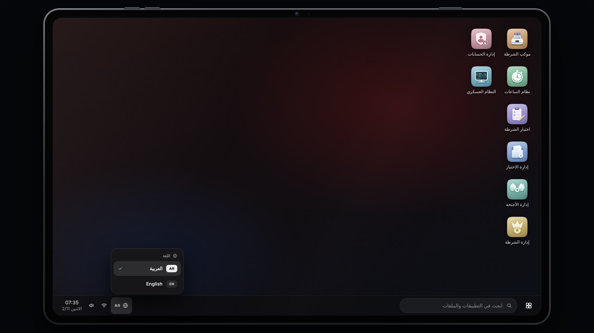

# اللغات

يدعم Police OS أي عدد من اللغات. كل لغة ملف واحد داخل `locales/lang/`، ويغيّر اللاعب لغته بنفسه من التابلت فتتغير الواجهة والتطبيقات والإشعارات فورًا.

## كيف يعمل؟

* **العربية هي لغة المصدر.** النص العربي في الكود هو نفسه «المفتاح» الذي تُبنى عليه الترجمة، ولذلك ملف `ar.lua` فارغ.
* اللغات المرفقة: العربية `ar` والإنجليزية `en` (ترجمة كاملة لنحو 800 نص).
* **لغة اللاعب:** يختارها من زر 🌐 (في شريط المهام وفي شاشة الدخول)، فتتغير فورًا نصوص التابلت وكل تطبيقاته، وإشعارات اللعبة، وقوائم qb-menu، وخيارات qb-target. تُحفظ على جهازه فتبقى في الدخول القادم.
* **لغة الإدارة:** هي `Config.Locale`. تُستعمل في كونسول السيرفر والسجلات ورسائل [الويبهوك](discord.md) وردود [الـ API](../admin/http-api.md)، وهي اللغة الافتراضية لمن لم يختر لغة.
* اللغة تُطبَّق على اللاعب وحده: لاعب بالإنجليزية ولاعب بالعربية يعملان معًا دون تأثير أحدهما على الآخر.



## إعدادات config.lua


```lua
Config.Locale              = 'ar'    -- لغة الإدارة واللغة الافتراضية
Config.AllowLanguageSwitch = true    -- false: إخفاء زر اللغة وإجبار الجميع على Config.Locale
-- Config.Languages        = { 'ar', 'en' }   -- (اختياري) حصر اللغات الظاهرة في الزر
Config.DebugLocale         = false   -- true: طباعة كل نص غير مترجم
```


* **`Config.Locale`** يجب أن يكون لها ملف في `locales/lang/`، وإلا يطبع المورد تحذيرًا ويرجع إلى `ar`.
* **`Config.AllowLanguageSwitch = false`** يخفي زر 🌐 ويجبر الجميع على `Config.Locale`.
* **`Config.Languages`** قائمة بيضاء تحصر ما يظهر في الزر. وهو معلّق افتراضيًا فتظهر كل لغات المجلد. لغة `Config.Locale` تظهر دائمًا.
* **`Config.DebugLocale = true`** يطبع كل نص عربي لا يجد له ترجمة، وهو مفيد وأنت تكمل ترجمة لغة جديدة. أطفئه في السيرفر الحي.

## إضافة لغة جديدة

الطريقة الأسهل أمر في **كونسول السيرفر** (لا يعمل من داخل اللعبة):

```
policeos_newlang fr Français ltr
```

| الجزء | المعنى |
|---|---|
| `fr` | رمز اللغة: أحرف لاتينية صغيرة وأرقام و`-` و`_`، يبدأ بحرف، حتى 12 حرفًا. الرمزان `ar` و`en` محجوزان |
| `Français` | الاسم الذي يظهر في زر اللغة (يقبل مسافات) |
| `ltr` أو `rtl` | اتجاه الواجهة. الافتراضي `ltr`. استعمل `rtl` للغات التي تُكتب من اليمين (كالفارسية والأردية) |

1. ينشئ الأمر `locales/lang/fr.lua` جاهزًا، فيه **كل** نصوص النظام، لكل نص قيمة فارغة `''` والترجمة الإنجليزية كتعليق بجانبه كتلميح. إن كان الملف موجودًا لا يُستبدل.
2. افتح الملف وترجم القيم الفارغة.
3. نفّذ `restart police-os`. تظهر اللغة تلقائيًا في زر 🌐 داخل التابلت.
4. تابع اكتمال الترجمة بالأمر:

```
policeos_langcheck fr -v
```

يعرض مثل `fr: 640 / 813 translated (78%) — 173 fall back to en`، والخيار `-v` يعرض النصوص الناقصة (حتى 200 نص).


بديل يدوي: انسخ `locales/lang/en.lua` باسم جديد، وغيّر الرمز في `LocaleAdd('en', {` وفي الجدول الأخير الذي فيه الاسم والاتجاه. ملفات اللغات ضمن الملفات المخصصة لتعديلك.


## صيغة ملف اللغة


```lua
LocaleAdd('fr', {
    ['فتح نظام الشرطة']   = 'Ouvrir le système',
    ['تم إضافة {1} ساعة'] = '{1} {1?heure|heures} ajoutée(s)',
}, { name = 'Français', dir = 'ltr' })
```


* **المفتاح** (يسار) هو النص العربي حرفيًا كما في الكود. لا تغيّره، وإنما ترجم القيمة (يمين).
* **`{1}` و`{2}`**: أجزاء متغيرة (اسم أو رقم) تبقى في مكانها، وتُترجَم بدورها إن أمكن.
* **`{1?مفرد|جمع}`**: في القيمة، يختار الصيغة المفردة إذا كان `{1}` يساوي 1، وإلا الجمع.
* **قيمة فارغة `''`** تعني «لم تُترجَم بعد» وتظهر بلغة الاحتياط.
* الجدول الأخير يحدد: `name` (الاسم في الزر)، و`dir` (`ltr` أو `rtl`)، و`fallback` (لغة الاحتياط).

### لغة الاحتياط

أي نص ناقص الترجمة يظهر بلغة الاحتياط بدل أن يظهر بالعربية:

* لكل لغة غير العربية والإنجليزية احتياطها الإنجليزية افتراضيًا.
* غيّره بـ `fallback = 'xx'` في الجدول الأخير، أو عطّله بـ `fallback = false` فيظهر النص العربي الأصلي.

## ما الذي يُترجَم تلقائيًا؟

| يُترجَم | لا يُترجَم |
|---|---|
| كل نص عربي في الواجهة وتطبيقاتها (النصوص، والتلميحات، وعناوين الحقول) | البيانات التي يكتبها المستخدمون: أسئلة الاختبار، وأنواع القضايا، وتقارير الحوادث، وأسماء الأجنحة التي ينشئها البوس |
| إشعارات اللعبة ورسائل السيرفر للاعب | نص لا يحتوي أي حرف عربي (يُعرض كما هو) |
| قوائم qb-menu وخيارات qb-target | |

**نصوص `config.lua` التي تكتبها أنت** (أسماء الأجنحة، وأسماء المركبات في الموكب، و`Config.Translations`...) تبقى بلغتك. إن كتبتها بالعربية فأضف النص العربي نفسه مفتاحًا في ملف كل لغة لتُترجَم. وإن كتبتها بلغة أخرى فستظهر كما هي لكل اللاعبين.

## نصوص ثابتة في الصفحة

نصوص شاشة الدخول الثابتة (مثل العنوان والتعليمات) تُترجَم من الملفات نفسها. أما اسم سيرفرك أسفل الشاشة فمن `Config.ServerName`، انظر [المظهر والأيقونات](appearance.md).
