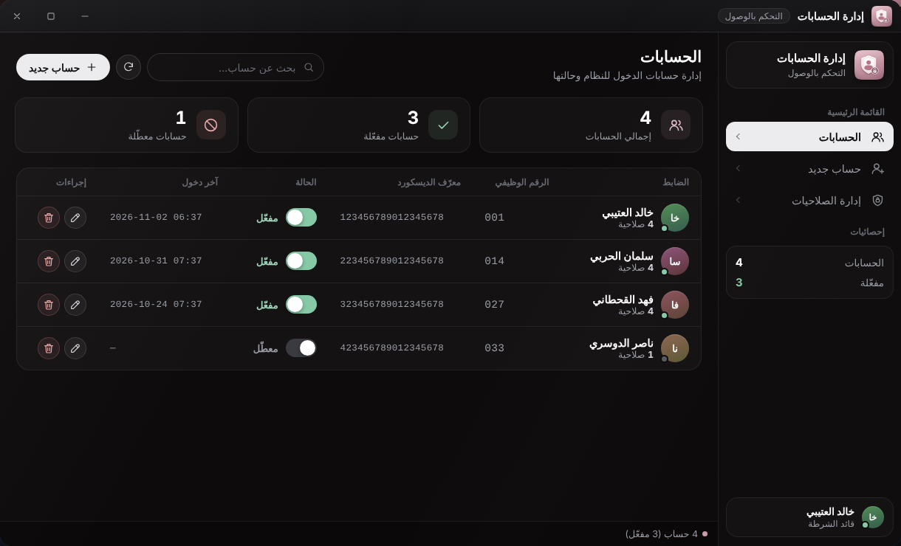
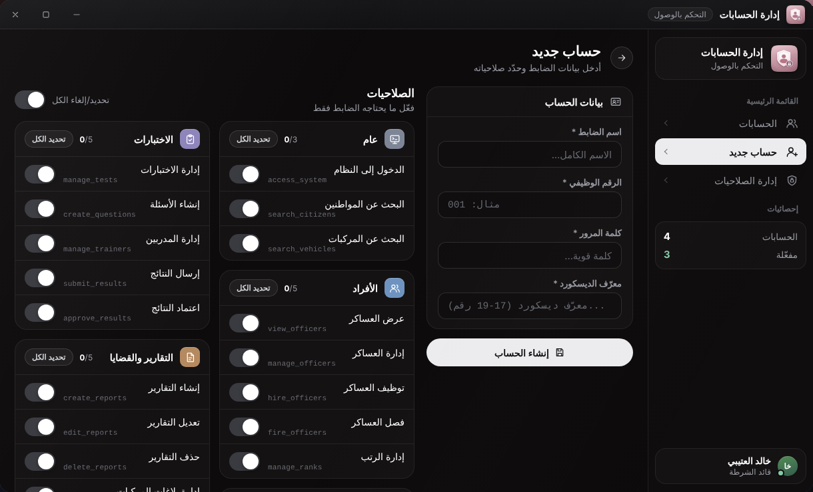
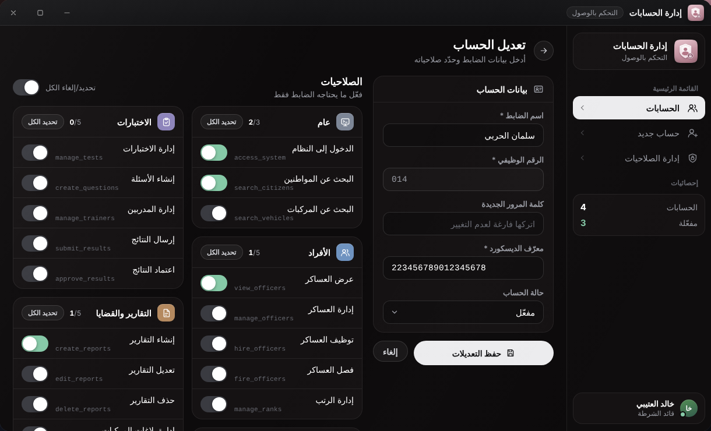
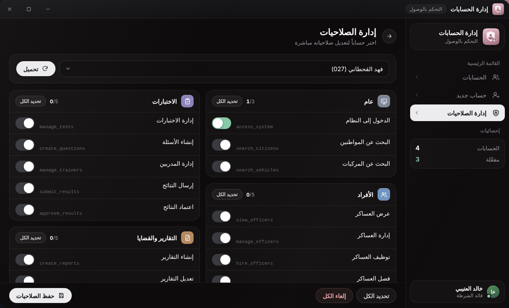

# إدارة الحسابات والصلاحيات

تطبيق **إدارة الحسابات** (التحكم بالوصول) لإنشاء حسابات دخول الضباط وتفعيلها وتعطيلها وتعديل صلاحياتها. يظهر لمن رتبته `BossMenu.MinGradeForBoss` فما فوق أو يملك `system_admin`، لكن **كل عملياته في السيرفر تتطلب `system_admin`** (والأدمن برتبة `Config.AdminGrade` فما فوق يملكها تلقائيًا).


إن خفّضت `BossMenu.MinGradeForBoss` إلى ما دون `Config.AdminGrade` فسيرى هؤلاء التطبيق دون أن يملكوا `system_admin`، فيظهر لهم فارغًا ويرفض السيرفر عملياتهم. اترك القيمتين متساويتين، أو امنح `system_admin` لمن تريد.


## ما هو الحساب؟

الحساب هو بيانات الدخول إلى التابلت: **رقم وظيفي** + **كلمة مرور** + **معرّف ديسكورد** + **الاسم** + **الصلاحيات**. وهو **غير مرتبط بشخصية معينة**: يعمل مع أي شخصية تحمل وظيفة الشرطة وتعرف بياناته. تفاصيل الأمان في [الأمان](../admin/security.md).

## قائمة الحسابات

* جدول فيه: الضابط (الاسم وعدد صلاحياته)، الرقم الوظيفي، معرّف الديسكورد، الحالة، آخر دخول، وإجراءات التعديل والحذف.
* مفتاح **الحالة** يفعّل الحساب أو يعطّله. التعطيل يلغي جلسته الحالية فورًا، وكلمة المرور الصحيحة بعدها تعطي «الحساب معطل».
* «بحث عن حساب...» بالاسم أو الرقم الوظيفي، وزر التحديث.
* في الشريط الجانبي إحصائيات: «الحسابات» و«مفعّلة».

## حساب جديد

كل الحقول مطلوبة («جميع الحقول مطلوبة»):

| الحقل | القواعد |
|---|---|
| الرقم الوظيفي | حتى 20 حرفًا، ولا يتكرر («هذا الرقم الوظيفي موجود بالفعل») |
| الاسم | حتى 100 حرف |
| كلمة المرور | من 6 إلى 100 حرف |
| معرّف الديسكورد | من 17 إلى 19 رقمًا |
| الصلاحيات | تُحدَّد بمفاتيح مجمّعة (انظر أدناه) |

تُخزَّن كلمة المرور مجزَّأة ولا تُعرَض لاحقًا في أي مكان.

## تعديل حساب

* تستطيع تعديل الاسم ومعرّف الديسكورد والحالة والصلاحيات.
* **كلمة المرور**: اتركها فارغة لتبقى كما هي. إن كتبت كلمة جديدة (6 أحرف فأكثر) تُغيَّر وتُلغى الجلسات الحالية للحساب.

## إدارة الصلاحيات

صفحة مخصصة لتعديل صلاحيات حساب موجود دون المرور بنموذج التعديل.

1. اختر حسابًا من القائمة واضغط «تحميل».
2. فعّل المفاتيح أو عطّلها، مجمّعة في أقسام: عام، الأفراد، الأجنحة، الساعات، الاختبارات، التقارير والقضايا، الموكب، الإدارة العليا. وللتحكم السريع «تحديد الكل» و«إلغاء تحديد الكل».
3. اضغط «حفظ الصلاحيات».

شرح كل صلاحية في [الصلاحيات](../configuration/permissions.md).


يُطبَّق التغيير في السيرفر **فورًا** على جلسة الضابط المفتوحة. أما التطبيقات الظاهرة على سطح مكتبه فتتحدّث عند إعادة تسجيل دخوله إلى التابلت.


## قواعد مهمة

* **منح `system_admin` و`boss_access` يتطلب أن تكون برتبة `Config.AdminGrade` فما فوق**. أي مدير نظام برتبة أقل تُحذف هاتان الصلاحيتان من أي حساب يحفظه، سواء عند الإنشاء أو التعديل (فتعديله لحساب يحملهما يسحبهما منه).
* تعطيل الحساب أو حذفه أو تغيير كلمة مروره يلغي جلساته على السيرفر.
* تبديل الشخصية أو الخروج من اللعبة يلغي الجلسة أيضًا.
* الأدمن برتبة `Config.AdminGrade` فما فوق يملك كل الصلاحيات تلقائيًا ولو كان حسابه فارغ الصلاحيات.

## البدائل من الكونسول ومن API

* [الأوامر](../admin/commands.md): `addofficer` و`chpassword` و`activateaccount` و`deactivateaccount` و`showaccounts` و`giveperm` وغيرها.
* [واجهة HTTP API](../admin/http-api.md): إنشاء الحسابات وتغيير كلمات المرور من موقعك أو بوتك.
