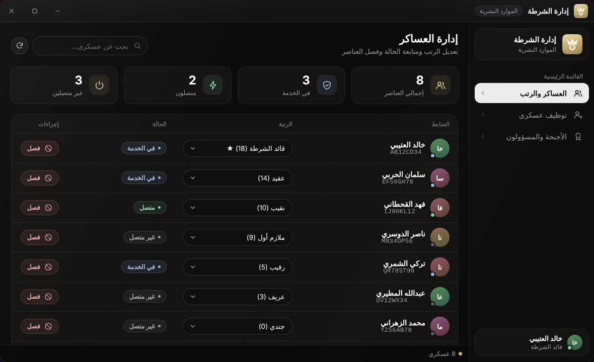
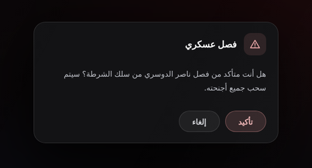
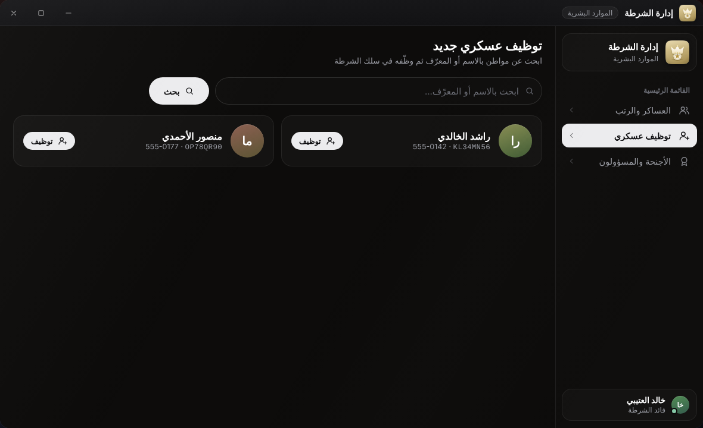
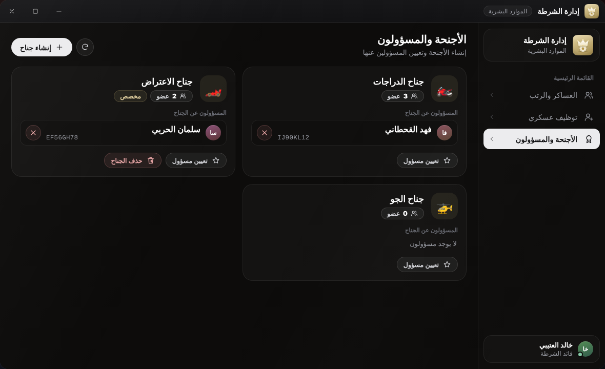
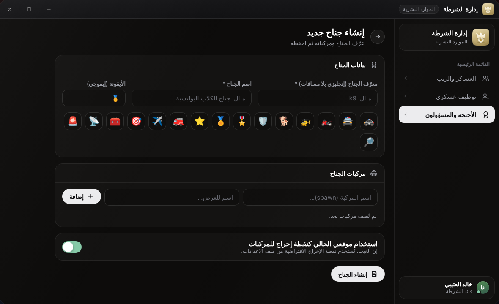

# إدارة الشرطة (البوس)

تطبيق **إدارة الشرطة** (الموارد البشرية) للقيادة العليا: ترقية العساكر وفصلهم وتوظيف الجدد وإدارة الأجنحة. يظهر لمن رتبته `BossMenu.MinGradeForBoss` فما فوق، أو يملك الصلاحية `boss_access`.

له ثلاث صفحات في الشريط الجانبي: **العساكر والرتب** و**توظيف عسكري** و**الأجنحة والمسؤولون**.

## العساكر والرتب

جدول لكل من يحمل وظيفة الشرطة (متصلين وغير متصلين) مرتبًا من الأعلى رتبة:

* **الرتبة**: قائمة منسدلة بكل رتب الوظيفة بصيغة «الاسم (الرقم)»، وعلامة ★ لرتبة البوس. اختيار رتبة يطلب تأكيدًا «تغيير الرتبة».
* **الحالة**: في الخدمة أو متصل أو غير متصل.
* **فصل**: يطلب تأكيدًا ثم يفصل الضابط.
* «بحث عن عسكري...» بالاسم أو المعرّف، وزر التحديث.

### قواعد الترقية والفصل

| القاعدة | التفاصيل |
|---|---|
| من يستطيع الترقية | البوس، أو من يملك `manage_ranks` |
| من يستطيع الفصل | البوس، أو من يملك `fire_officers` |
| الرتبة المطلوبة | يجب أن تكون موجودة في رتب الوظيفة، وإلا «هذه الرتبة غير معرّفة في الوظيفة» |
| على من تُطبَّق | لا يمكنك إجراؤها على نفسك، ولا على من رتبته تساوي رتبتك أو أعلى |
| الرتبة الممنوحة | لا يمكنك منح رتبة تساوي رتبتك أو أعلى منها |

* الإعداد `BossMenu.AllowManageEqualGrade = true` يسمح بالتعامل مع من يساويك في الرتبة ومنحه رتبتك.
* **الفصل** يجعل الوظيفة `unemployed` برتبة 0، ويحذف أجنحة الضابط وإشرافه عليها، ويصله «⚠ تم فصلك من سلك الشرطة».
* تغيير الرتبة والفصل يعملان على اللاعب المتصل مباشرة، وعلى غير المتصل بتعديل بياناته في قاعدة البيانات.
* تغيير الرتبة من هذا التطبيق يضع الضابط دائمًا على وظيفة `Config.PoliceJob`.

## توظيف عسكري

1. اكتب اسم المواطن أو معرّفه (حرفان على الأقل) واضغط «بحث». يعرض البحث حتى 25 نتيجة، لكل مواطن بطاقة فيها الاسم والمعرّف والهاتف.
2. اضغط «توظيف» على البطاقة ثم أكّد في النافذة «توظيف عسكري».

يُعيَّن في وظيفة الشرطة بالرتبة `BossMenu.HireGrade` (الافتراضي 0)، ويصله «🎉 تم توظيفك في سلك الشرطة!». إن كان ضابطًا أصلًا يظهر «هذا الشخص شرطي بالفعل». يتطلب التوظيف البوس أو الصلاحية `hire_officers`.


بحث المواطنين هنا هو نفسه بحث MDT، فيتطلب صلاحية `access_system` أو `boss_access`.


## الأجنحة والمسؤولون

لكل جناح بطاقة فيها اسمه وعدد أعضائه (وعلامة «مخصص» للأجنحة المنشأة من التطبيق) والمسؤولون عنه. ومن هنا:

* **«تعيين مسؤول»** (وزر × لإزالته): للبوس فقط. تكتب معرّف المواطن (Citizen ID). المسؤول يُضاف عضوًا تلقائيًا، ويصله «⭐ تم تعيينك مسؤولاً عن جناح: …».
* **«إنشاء جناح»**: للبوس أو من يملك `create_wings`.
* **«حذف الجناح»**: للبوس أو من يملك `delete_wings`، ولـ**الأجنحة المخصصة فقط** (المنشأة من هنا). الأجنحة المكتوبة في `config.lua` لا تُحذف من التطبيق («لا يمكن حذف هذا الجناح (غير مخصص)»). الحذف يسحب الجناح من كل أعضائه ومسؤوليه.

### إنشاء جناح

| الحقل | القواعد |
|---|---|
| معرّف الجناح (إنجليزي بلا مسافات) * | يُحوَّل إلى أحرف صغيرة وتُحذف المسافات وكل ما ليس حرفًا إنجليزيًا أو رقمًا أو `_`، حتى 40 حرفًا، ويجب ألّا يتكرر مع جناح موجود («يوجد جناح بنفس المعرّف مسبقاً») |
| اسم الجناح * | حتى 60 حرفًا |
| الأيقونة (إيموجي) | حتى 4 رموز، والافتراضي 🏅، ويمكن اختيارها من صف الرموز الجاهزة |
| مركبات الجناح | حتى 20 مركبة، لكل واحدة اسم الموديل (spawn) واسم للعرض |
| استخدام موقعي الحالي كنقطة إخراج للمركبات | **مفعّل افتراضيًا**: تُؤخذ إحداثيات اللاعب واتجاهه لحظة الإنشاء. إن ألغيته تُستعمل `BossMenu.DefaultWingSpawn` |

اضغط «إنشاء الجناح» للحفظ.


وقوفك لحظة الإنشاء في مكان غير مناسب يعني أن مركبات الجناح ستظهر هناك. وقف عند مكان الإخراج المطلوب قبل الإنشاء، أو ألغِ الخيار لاستعمال النقطة الافتراضية.


الجناح الجديد يُحفظ في قاعدة البيانات ويصير متاحًا فورًا لكل اللاعبين دون إعادة تشغيل.

## الإعدادات المتعلقة

| المفتاح | الافتراضي | المعنى |
|---|---|---|
| `BossMenu.MinGradeForBoss` | 18 | أدنى رتبة تُعدّ «بوس» |
| `BossMenu.HireGrade` | 0 | رتبة الضابط الجديد عند التوظيف |
| `BossMenu.AllowManageEqualGrade` | false | هل يتحكم البوس بمن يساويه في الرتبة |
| `BossMenu.DefaultWingSpawn` | `vector4(...)` | نقطة الإخراج للأجنحة المنشأة من التطبيق إن لم يحدّد البوس موقعه |
