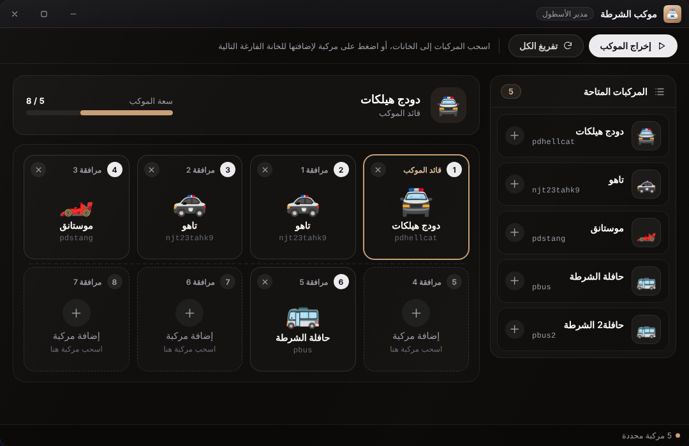

# موكب الشرطة

تطبيق **موكب الشرطة** (مدير الأسطول) يجهّز موكبًا من عدة مركبات ويُخرجه دفعة واحدة. يراه كل من سجّل الدخول، لكن **الإخراج** يتطلب الصلاحية `spawn_convoy` (مفعّلة افتراضيًا للحسابات الجديدة).



## طريقة الاستخدام

1. تظهر خانات الموكب: الأولى «قائد الموكب» ثم «مرافقة 1» وما بعدها. عددها `Config.ConvoySlots` (الافتراضي 8).
2. في اللوحة اليمنى «المركبات المتاحة» (من `Config.ConvoyVehicles`): **اسحب** مركبة إلى خانة، أو اضغط عليها لتدخل أول خانة فارغة.
3. اضغط «إخراج الموكب».
4. «تفريغ الكل» يمسح الخانات. زر × على كل خانة يزيل مركبتها.

يعرض أعلى النافذة «سعة الموكب» (مثل 5/8) ويعرض أسفلها عدد المركبات المحددة.

## ماذا يتحقق منه السيرفر؟

عند «إخراج الموكب» يفحص السيرفر ما يلي، وأي فشل يُظهر إشعارًا:

| الفحص | الرسالة عند الفشل |
|---|---|
| يملك الضابط `spawn_convoy` | لا تملك الصلاحية |
| القائمة غير فارغة ولا تزيد على `ConvoySlots` | اختيار غير صحيح |
| كل مركبة موجودة في `Config.ConvoyVehicles` | مركبة غير مسموحة |
| انقضى `ConvoyCooldown` ثانية منذ آخر إخراج لنفس الشخصية | انتظر N ثانية قبل إخراج موكب جديد |


مهلة الانتظار تُحفظ في ذاكرة السيرفر فقط، فتُصفَّر عند إعادة تشغيل المورد، وتبدأ لحظة قبول الطلب.


## أين تظهر المركبات؟

يُخرج الموكب **عند `Config.ConvoyBaseCoords` وليس عند موقع اللاعب**: المركبة الأولى عند النقطة، وكل مركبة بعدها خلف التي قبلها بمسافة `Config.SpawnDistance` متر على امتداد اتجاه النقطة. تأكد أن النقطة في مكان مفتوح (موقف أو مرآب) على خريطتك.

* يحصل الضابط على **مفاتيح المركبة الأولى** (حدث `vehiclekeys:client:SetOwner`) ويظهر «تم منحك مفاتيح المركبة».
* تعمل محركات المركبات ويُنظَّف الغبار منها.
* إن تعذّر تحميل موديل يظهر «تعذّر تحميل الموديل: اسم_الموديل» وتُكمل بقية المركبات.

## تخصيص المركبات

كل مركبة في `Config.ConvoyVehicles` تقبل هذه المفاتيح:

| المفتاح | المعنى |
|---|---|
| `model` | اسم موديل المركبة في اللعبة (مطلوب) |
| `label` | الاسم الظاهر في التطبيق |
| `icon` | رمز تعبيري يظهر على بطاقة المركبة |
| `livery` | رقم الـ livery (اختياري) |
| `extras` | جدول `{ [رقم] = true/false }` لتفعيل الإضافات أو تعطيلها (اختياري) |
| `maxMods` | ضع `false` لإلغاء رفع التعديلات للحد الأقصى (اختياري) |


```lua
Config.ConvoyVehicles = {
    { model = 'pdhellcat', label = 'دودج هيلكات',  icon = '🚔', livery = 3 },
    { model = 'pdstang',   label = 'موستانق',      icon = '🏎️', maxMods = false },
    { model = 'pbus',      label = 'حافلة الشرطة', icon = '🚌', extras = { [1] = true, [2] = false } },
}
```


* إن لم تضع `extras` تُفعَّل كل الإضافات الموجودة من 1 إلى 8.
* ما لم تضع `maxMods = false` تُرفع تعديلات المحرك والفرامل وناقل الحركة والتعليق والدرع، ويُفعَّل التيربو والزينون، وتصبح الإطارات غير قابلة للانفجار، ويُضبط تظليل النوافذ.


بعض الموديلات الافتراضية في `config.lua` (مثل `pdhellcat` و`njt23tahk9` و`pdstang`) أسماء **مركبات إضافية (addon)** من حزم مركبات خارجية وليست من اللعبة الأصلية. إن لم تكن مثبّتة عندك فاستبدلها بموديلات مثبّتة (مثل `police` أو `police2` من اللعبة)، وإلا ستظهر رسالة «تعذّر تحميل الموديل».


الإعدادات الأخرى للموكب (`ConvoyBaseCoords` و`SpawnDistance` و`ConvoySlots` و`ConvoyCooldown`) موضّحة في [مرجع config.lua](../configuration/config-reference.md).
