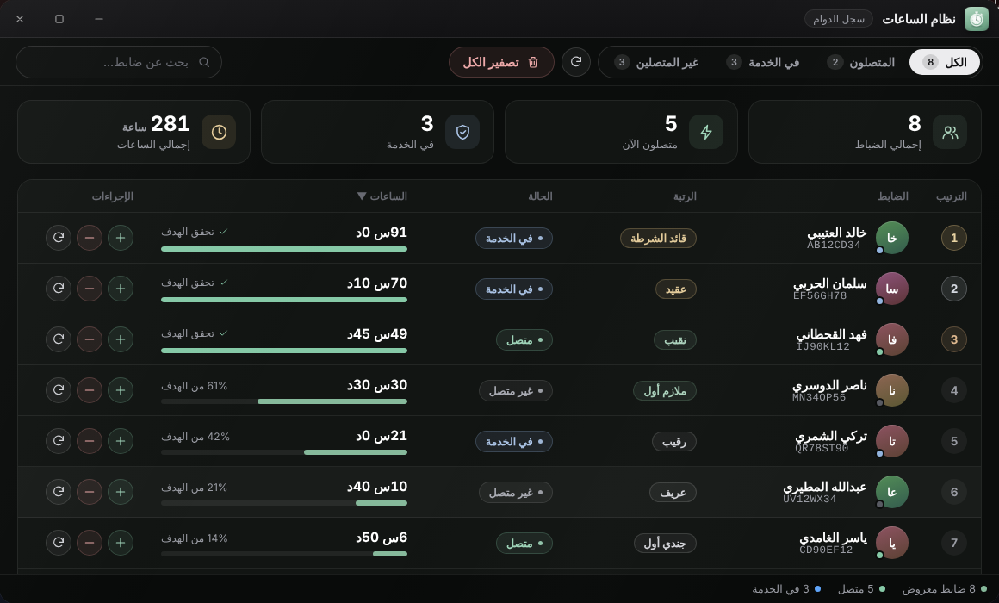
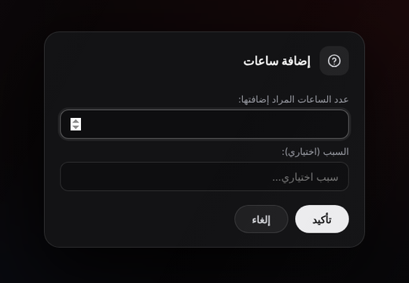

# نظام الساعات

تطبيق **نظام الساعات** (سجل الدوام) يعرض ساعات خدمة كل ضابط، ويتيح لمن يملك الصلاحية إضافتها أو خصمها أو تصفيرها. يراه كل من سجّل الدخول.

## كيف تُحسب الساعات؟

* كل **60 ثانية** يضيف السيرفر **دقيقة واحدة** لكل ضابط متصل يحمل وظيفة الشرطة (أو وظيفة إضافية) وحالته **في الخدمة**.
* «في الخدمة» هي حالة الدوام في وظيفة QBCore (`onduty`)، أي الحالة التي يغيّرها نظام الدوام عندك.
* تُحفظ الدقائق في جدول `police_hours` على `citizenid` الضابط، وتبقى بعد إعادة التشغيل.
* لإيقاف الاحتساب كله اضبط `Config.HoursSystem = { enabled = false }`.

## ما يعرضه التطبيق

* بطاقات في الأعلى: «إجمالي الضباط» و«متصلون الآن» و«في الخدمة» و«إجمالي الساعات».
* مرشحات مع العدّاد: «الكل» و«المتصلون» (متصل وليس في الخدمة) و«في الخدمة» و«غير المتصلين».
* «بحث عن ضابط...» وزر تحديث وترتيب بحسب الساعات من رأس عمود «الساعات».
* جدول فيه: الترتيب، الضابط (الاسم والمعرّف)، الرتبة، الحالة، الساعات مع شريط تقدم، والإجراءات.
* القائمة تضم **كل** من يحمل وظيفة الشرطة في قاعدة البيانات، المتصلين وغير المتصلين.

شريط التقدم يقيس الساعات مقابل هدف **50 ساعة** (3000 دقيقة): يكتب «NN% من الهدف»، وعند بلوغه «تحقق الهدف».


هدف الـ 50 ساعة رقم ثابت في الواجهة (`HO_GOAL_MIN` في `html/script.js`) وليس إعدادًا في `config.lua`.


## الإجراءات حسب الصلاحية

| الزر | يتطلب | ما يفعله |
|---|---|---|
| ＋ | `add_hours` | إضافة ساعات لضابط |
| − | `remove_hours` | خصم ساعات من ضابط |
| ↻ | `reset_hours` | تصفير ساعات ضابط |
| «تصفير الكل» | `reset_hours` | تصفير ساعات جميع الضباط (بعد تأكيد) |

* تقبل الإضافة والخصم أرقامًا عشرية (مثل 1.5)، على أن تكون أكبر من 0 وحتى 10000 ساعة.
* الخصم يفشل برسالة «الساعات غير كافية» إن كان رصيد الضابط أقل من المطلوب.
* يصل الضابط المتأثر إشعار (إن كان متصلًا) بالإضافة أو الخصم أو التصفير.
* تصفير ضابط واحد أو الكل يطلب تأكيدًا قبل التنفيذ، والتصفير لا رجعة فيه.


نافذة الإضافة والخصم فيها حقل «السبب (اختياري)»، لكنه **لا يُحفظ ولا يُسجَّل حاليًا**: يتجاهله السيرفر.


## ملاحظات

* الصلاحيتان `manage_hours` و`view_officers` معرّفتان في قائمة الصلاحيات لكنّ الكود لا يفحصهما: الذي يتحكم فعليًا هو `add_hours` و`remove_hours` و`reset_hours` فقط. انظر [الصلاحيات](../configuration/permissions.md).
* تغيير `Config.MinGradeForHours` لا يؤثر في شيء حاليًا (إعداد غير مستعمل).
