# النظام العسكري (MDT)

تطبيق **النظام العسكري** (محطة العمليات) هو قاعدة بيانات الشرطة: سجلات المواطنين وبحث المركبات وتقارير الحوادث والقضايا وتصنيف العساكر. يظهر لمن يملك الصلاحية `access_system` (وهي مفعّلة افتراضيًا للحسابات الجديدة).

يحتوي الشريط الجانبي على بطاقة الضابط، وأربع صفحات: **سجلات المواطنين** و**بحث المركبات** و**تقارير الحوادث** و**تصنيف العساكر**، وفي أسفله الوقت الحالي وحالة الاتصال.

## سجلات المواطنين

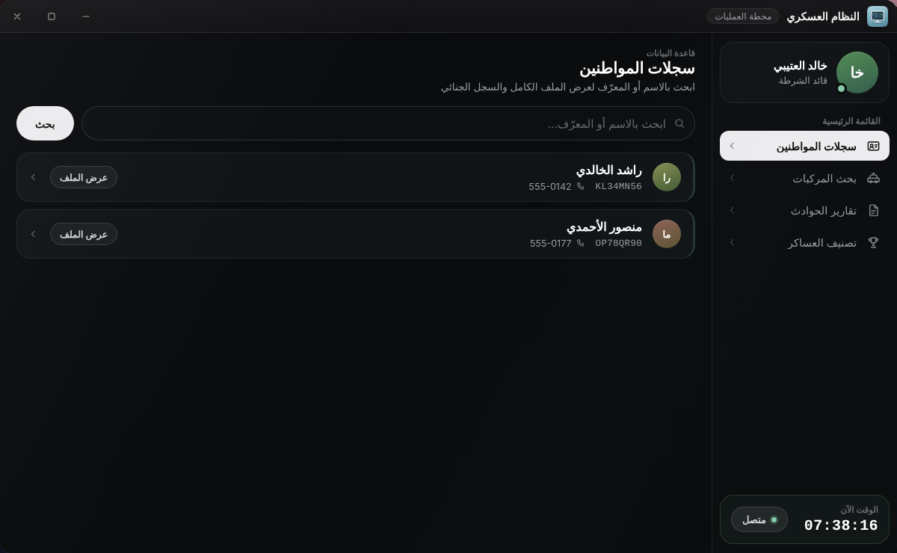

اكتب اسم المواطن أو معرّفه (Citizen ID) في «ابحث بالاسم أو المعرّف...» واضغط «بحث». يطابق البحث المعرّف والاسم الأول واسم العائلة والاسم الكامل، ويتطلب **حرفين على الأقل** ويعرض حتى **25 نتيجة** (الاسم والمعرّف والهاتف). اضغط على مواطن لفتح ملفه.

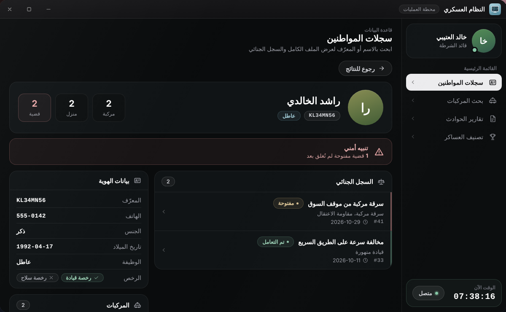

| القسم | محتواه |
|---|---|
| أعلى الملف | الاسم، والمعرّف، والوظيفة، وبطاقات عدد المركبات والمنازل والقضايا |
| تنبيه أمني | يظهر إن كانت للمواطن قضايا **مفتوحة** لم تُغلق بعد |
| بيانات الهوية | المعرّف، الهاتف، الجنس، تاريخ الميلاد، الوظيفة، والرخص (قيادة وسلاح) |
| السجل الجنائي | التقارير التي ورد فيها كمشتبه به (حتى 30 تقريرًا) مع حالة كل تقرير |
| المركبات | مركباته المسجّلة (حتى 20) |
| المنازل | منازله (حتى 30) وزر «تحديد الموقع» يضع علامة على الخريطة |


البيانات تُقرأ من جداول QBCore القياسية: `players` و`player_vehicles`. وقسم المنازل يقرأ من الجدول `next_housing` إن وُجد، وإن لم يوجد يبقى فارغًا بلا أخطاء.


## بحث المركبات

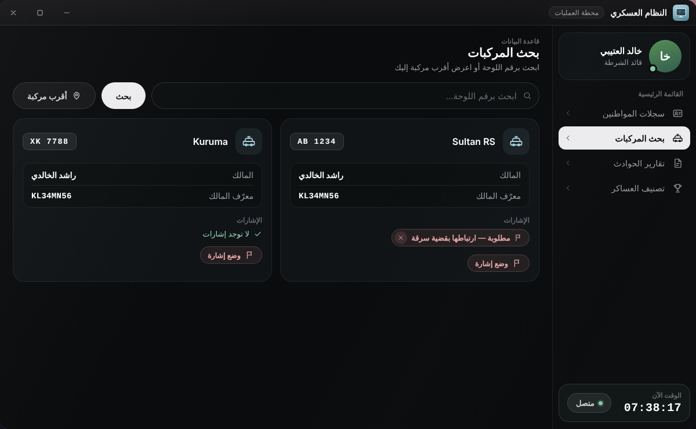

اكتب جزءًا من رقم اللوحة (حرفان على الأقل، حتى 25 نتيجة). تعرض كل بطاقة: الموديل ورقم اللوحة والمالك ومعرّفه والإشارات.

### أقرب مركبة

زر «أقرب مركبة» يبحث عن أقرب مركبة إليك **ضمن 15 مترًا** ويعرض بياناتها، مع المسافة وحالة التسجيل («مسجّلة» أو «غير مسجّلة»). وإن لم توجد تظهر «لا توجد مركبة قريبة».

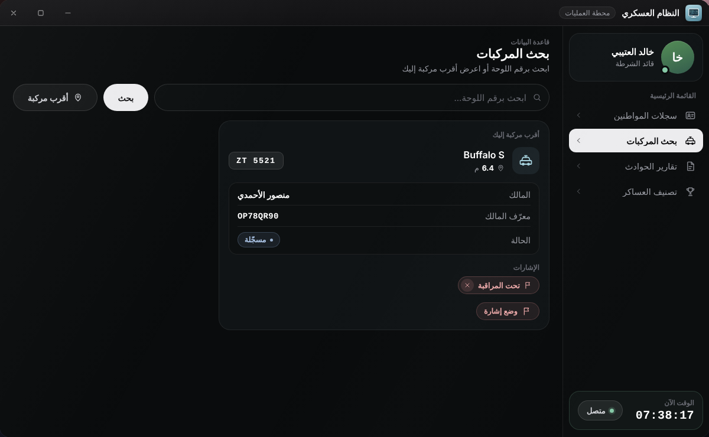

### إشارات المركبات

زر «وضع إشارة» على بطاقة المركبة يفتح نافذة تطلب **نوع الإشارة** (مقترحاتها: مطلوبة / مسروقة / غير مؤمّنة / تحت المراقبة) و**السبب** (اختياري). تظهر الإشارة على البطاقة بعلامة ×، وضغطها يزيلها.

* السيرفر يقبل أي نص كنوع إشارة (حتى 50 حرفًا) والسبب حتى 150 حرفًا، ويحفظ اسم الضابط الذي وضعها في جدول `mdt_vehicle_flags`.
* **وضع الإشارة وإزالتها يتطلبان الصلاحية `manage_flags`** (مفعّلة افتراضيًا).


الزرّان ظاهران لكل مستخدم MDT، ويظهر إشعار النجاح دائمًا. أما السيرفر فلا يحفظ ولا يزيل إلا لمن يملك `manage_flags`، فاضغط بحثًا جديدًا للتأكد من النتيجة.


## تقارير الحوادث

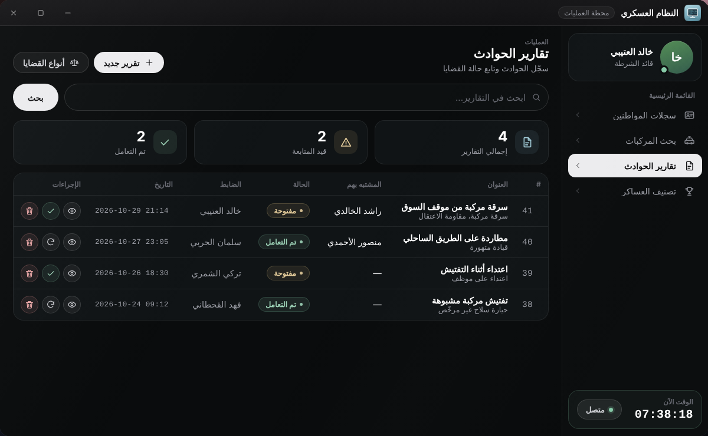

* بطاقات في الأعلى: «إجمالي التقارير» و«قيد المتابعة» و«تم التعامل».
* «ابحث في التقارير...» يبحث في العنوان واسم المشتبه به ومعرّفه ونوع التقرير. تُعرض آخر **60** نتيجة.
* لكل تقرير حالة: **مفتوحة** أو **تم التعامل**.
* «تقرير جديد» لإنشاء تقرير، و«أنواع القضايا» (لمن يملك `manage_case_types`).

### إنشاء تقرير

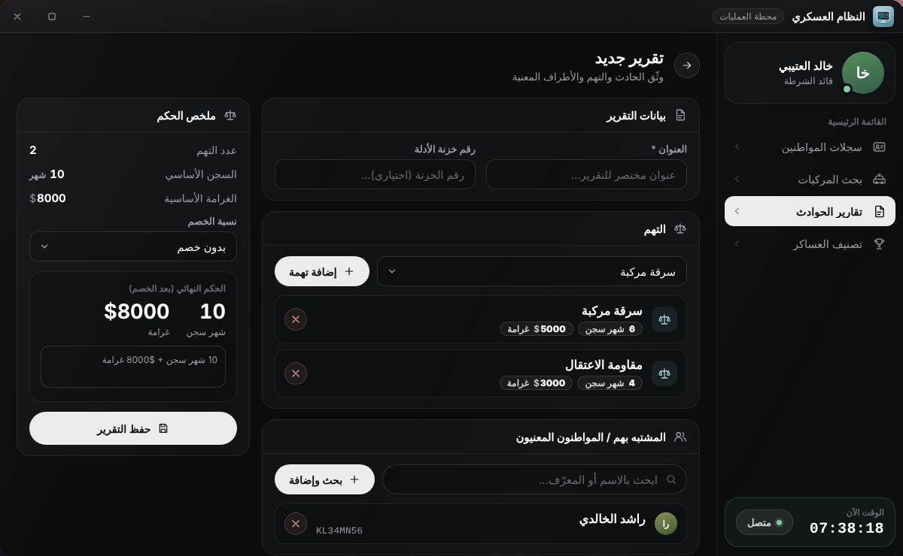

يتطلب إنشاء التقرير الصلاحية `create_reports` (مفعّلة افتراضيًا). الحقول:

| القسم | الوصف |
|---|---|
| العنوان * | مطلوب، حتى 150 حرفًا |
| رقم خزنة الأدلة | اختياري |
| التهم | اختر تهمة من القائمة واضغط «إضافة تهمة». **يلزم تهمة واحدة على الأقل** |
| المشتبه بهم / المواطنون المعنيون | «بحث وإضافة» مواطنين بالاسم أو المعرّف (حتى 20) |
| العساكر المشاركون في الحالة | أضف الضباط المشاركين (حتى 20) |
| تفاصيل الحادث | وصف كامل (حتى 5000 حرف) |

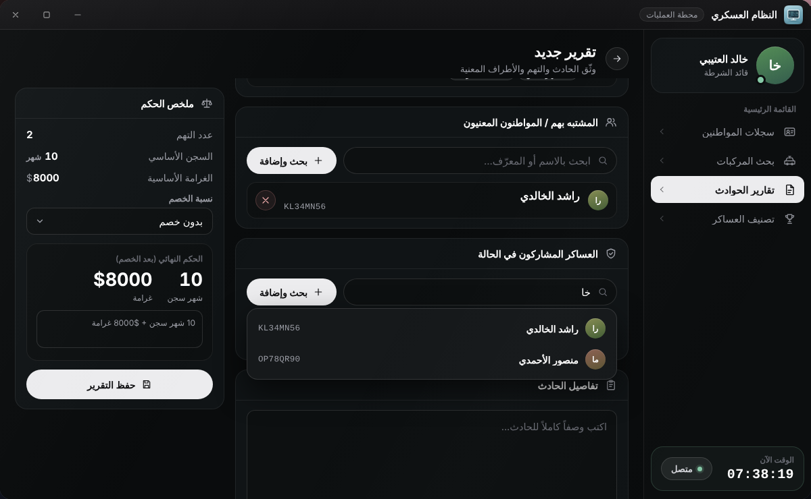

لوحة **ملخص الحكم** تحسب تلقائيًا: عدد التهم، والسجن الأساسي بالأشهر، والغرامة الأساسية، ثم **نسبة الخصم** (بدون خصم، 10%، 25%، 50%، 75%) و«الحكم النهائي (بعد الخصم)». اضغط «حفظ التقرير» للحفظ. يصل الحكم إلى السيرفر كما حُسب في التابلت.

عند الحفظ يظهر «✔ تم حفظ التقرير رقم #N» وتُرسل رسالة «📝 تقرير جديد» إلى ويبهوك **MDT** (إن ضبطته).


قائمة التهم تأتي من **أنواع القضايا**، ولا توجد أنواع افتراضية. إن لم تُضف أنواعًا ستظهر «لا توجد أنواع قضايا معرّفة بعد» ولن يستطيع أحد حفظ تقرير. أضفها أولًا كما يلي.


### عرض تقرير وإدارته

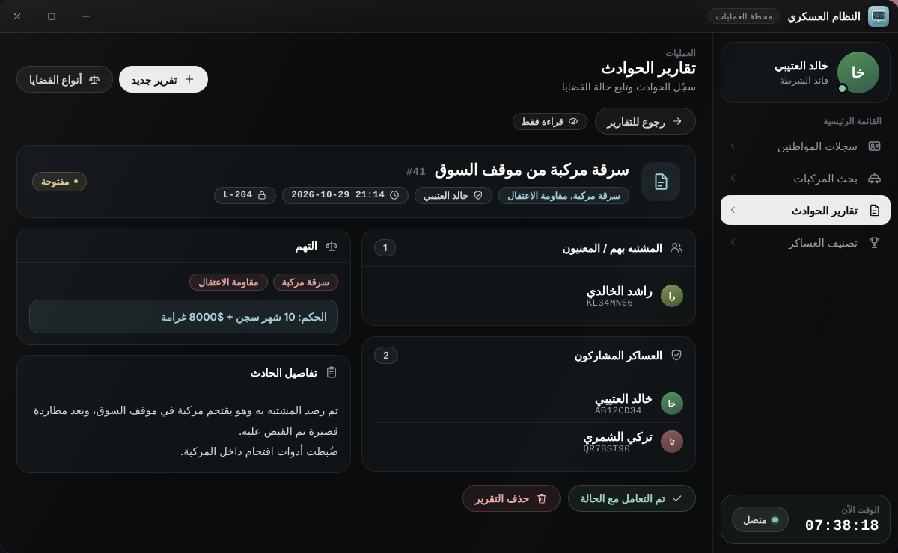

* **«تم التعامل مع الحالة»**: يستطيعها أي مستخدم MDT.
* **«إعادة فتح الحالة»** و**«حذف التقرير»** (بعد تأكيد): يجب أن تكون رتبتك `Config.MinGradeForManager` فما فوق في السيرفر، وللحذف يكفي أيضًا الصلاحية `delete_reports`.


زرّا «إعادة فتح الحالة» و«حذف التقرير» لا يظهران في الواجهة إلا لمن رتبته **10 فما فوق** (الرقم ثابت داخل `html/script.js`)، حتى لو منحت الضابط `delete_reports`.


### أنواع القضايا

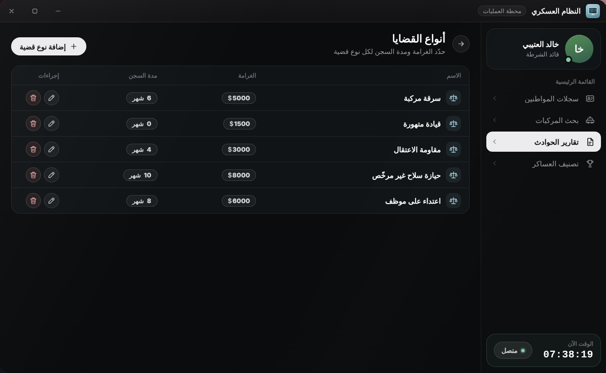

يديرها من يملك `manage_case_types`. لكل نوع: **اسم القضية** و**الغرامة ($)** و**مدة السجن (بالأشهر)**.

1. اضغط «أنواع القضايا» في صفحة تقارير الحوادث.
2. اضغط «إضافة نوع قضية».
3. أدخل الاسم والغرامة والسجن واضغط «حفظ».

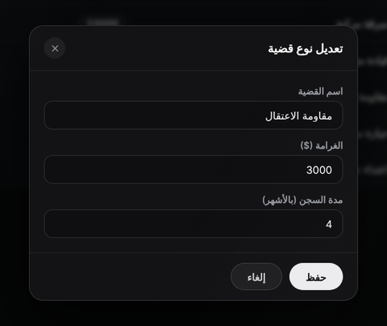

يمكن تعديل أي نوع أو حذفه لاحقًا. تُخزَّن في جدول `mdt_case_types` (الغرامة حتى 100,000,000 والسجن حتى 100,000).


قائمتا `Config.MDT.Charges` و`Config.MDT.IncidentTypes` في `config.lua` **غير مستعملتين**: التهم تأتي من قاعدة البيانات، وأنواع الإشارات مكتوبة في الواجهة. انظر [مرجع config.lua](../configuration/config-reference.md).


## تصنيف العساكر

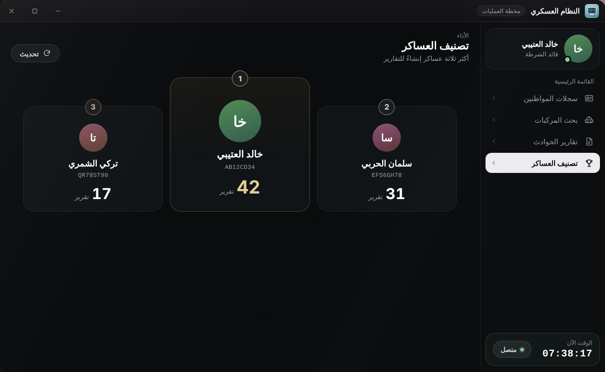

يعرض **أكثر ثلاثة عساكر** إنشاءً للتقارير (بحسب عدد تقاريرهم)، مع زر تحديث.

## الصلاحيات المتعلقة

| الصلاحية | تأثيرها في MDT |
|---|---|
| `access_system` | ظهور التطبيق وكل البحث والعرض |
| `create_reports` | إنشاء التقارير |
| `manage_flags` | وضع إشارات المركبات وإزالتها |
| `manage_case_types` | إضافة أنواع القضايا وتعديلها وحذفها |
| `delete_reports` | حذف التقارير (يُضاف إلى شرط الرتبة) |
| `search_citizens` و`search_vehicles` و`edit_reports` | معرّفة في القائمة لكن الكود لا يفحصها حاليًا |
