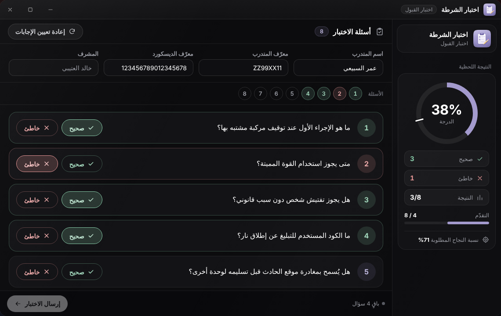
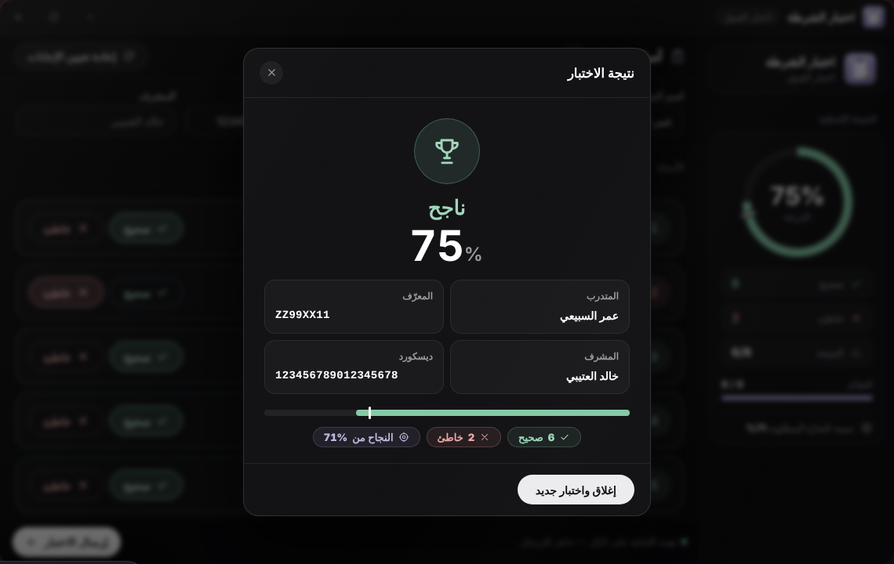

# اختبار الشرطة

تطبيق **اختبار الشرطة** (اختبار القبول) يستخدمه **المدرّب** لتقييم متدرب شفهيًا ثم إرسال نتيجته. أسئلة الاختبار يضعها مدير الاختبار من [إدارة الاختبار](test-management.md).

## من يراه؟

يظهر التطبيق لمن كان:

* **مدرّبًا معتمدًا** (مُضافًا في تبويب «المدربون»)، أو
* يملك الصلاحية `submit_results`، أو
* مدير اختبار: يملك `manage_tests` أو رتبته `TestSystem.MinGradeToManage` فما فوق.

يمكن للمدرّب فتحه مباشرة بالأمر `/policetest`.

## طريقة التقييم



1. اكتب **اسم المتدرب** و**معرّف المتدرب** (Citizen ID) و**معرّف الديسكورد** (من 17 إلى 19 رقمًا). حقل **المشرف** هو اسمك ويظهر للقراءة فقط.
2. اطرح الأسئلة على المتدرب. وعلى كل سؤال اضغط **صحيح** أو **خاطئ** بحسب إجابته: أنت من يقيّم، والنظام لا يعرف الإجابات.
3. تتحدّث لوحة «النتيجة اللحظية» في الجانب مع كل علامة: حلقة النسبة، وعدّاد صحيح وخاطئ، والتقدّم، و«نسبة النجاح المطلوبة».
4. عند الإجابة عن كل الأسئلة يُفعَّل زر **إرسال الاختبار** (قبل ذلك يظهر «أجب على كل الأسئلة للإرسال»).
5. تظهر نافذة «نتيجة الاختبار»: **ناجح** أو **راسب** مع النسبة.



* «إعادة تعيين الإجابات» تمسح علامات الأسئلة كلها.
* «إغلاق واختبار جديد» تغلق النافذة لتبدأ بمتدرب آخر.
* إن لم تُحفظ أسئلة بعد تظهر الرسالة «لا توجد أسئلة اختبار بعد» فاطلب من مدير الاختبار إعدادها.


نافذة «نتيجة الاختبار» تظهر في التابلت فور الضغط على «إرسال الاختبار»، **قبل** أن يؤكد السيرفر الحفظ. تأكد من وصول إشعار «✔ تم إرسال النتيجة! رقم #…». وإن ظهر إشعار خطأ (مثلًا «بيانات المتدرب غير صحيحة (تحقق من معرّف الديسكورد)») فلم تُحفظ النتيجة، فأعد الإرسال بعد التصحيح.


## ماذا يفعل السيرفر عند الإرسال؟

* يتأكد أنك مدرّب، وأن البيانات سليمة: عدد الأسئلة من 1 إلى 200، وعدد الصحيح ضمن المدى، واسم المتدرب والمعرّف غير فارغين، ومعرّف الديسكورد صالحًا.
* يحسب النسبة بنفسه ويحفظ النتيجة في جدول `police_test_results` بحالة **`pending`** (قيد المراجعة) ويعطيها رقمًا.
* يرسل إلى ويبهوك **Results** (`police_wh_results`) رسالة «📋 نتيجة اختبار الشرطة» فيها: رقم النتيجة والمتدرب والمعرّف وديسكورد والمدرّب والنتيجة (ناجح أو راسب بحسب `PassPercentage`).


النجاح في الاختبار **لا يقبل المتدرب تلقائيًا**. القبول والرفض قرار مدير الاختبار بالأمرين التاليين.


## قبول المتدرب أو رفضه

يُنفَّذ الأمران **من داخل اللعبة فقط** بواسطة مدير اختبار (`manage_tests` أو رتبة `TestSystem.MinGradeToManage` فما فوق). رقم النتيجة تجده في الإشعار وفي رسالة الويبهوك:

```text
/accepttest [رقم_النتيجة]
/rejecttest [رقم_النتيجة]
```

| الأمر | ما يحدث |
|---|---|
| `/accepttest` | تتحول حالة النتيجة إلى `accepted`، ويُعيَّن المتدرب في وظيفة الشرطة بالرتبة `TestSystem.AcceptedGrade` (فورًا إن كان متصلًا، أو بتعديل بياناته في قاعدة البيانات إن كان غير متصل)، ويصله «🎉 مبروك! تم قبولك في سلك الشرطة!»، وتُرسل رسالة «✅ تم قبول متدرب» إلى ويبهوك **Accepted** |
| `/rejecttest` | تتحول الحالة إلى `rejected`، ويصل المتدرب «❌ لم يتم قبول طلبك في اختبار الشرطة.»، وتُرسل رسالة «❌ تم رفض متدرب» إلى ويبهوك **Rejected** |

* يعمل الأمران على النتائج بحالة `pending` فقط، وإلا يظهر «تمت معالجتها مسبقاً».
* رقم غير موجود يعطي «النتيجة #N غير موجودة».
* لا يعمل الأمران من كونسول السيرفر (يتجاهلهما السيرفر بصمت).
* لا يشترط النظام أن يكون المتدرب ناجحًا ليُقبَل: للمدير أن يقبل أو يرفض أي نتيجة `pending`.

## الإعدادات المتعلقة

| المفتاح في `config.lua` | الافتراضي | المعنى |
|---|---|---|
| `TestSystem.PassPercentage` | 71 | نسبة النجاح التي تُظهر «ناجح» وتُكتب في الويبهوك |
| `TestSystem.AcceptedGrade` | 0 | الرتبة التي يُعيَّن بها المتدرب عند `/accepttest` |
| `TestSystem.MinGradeToManage` | 10 | أدنى رتبة تُعدّ «مدير اختبار» دون الحاجة لصلاحية |
| `TestSystem.Colors` | — | ألوان رسائل الويبهوك (Results وAccepted وRejected) |
