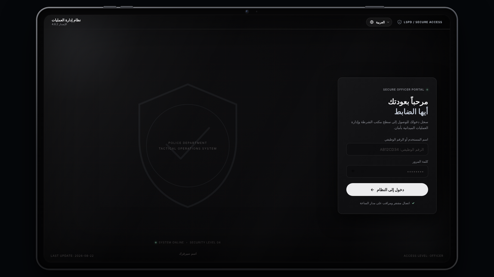
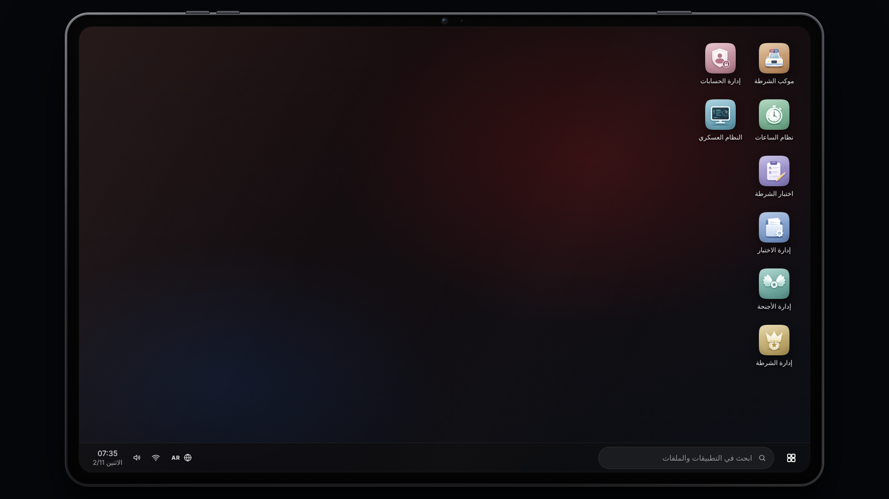
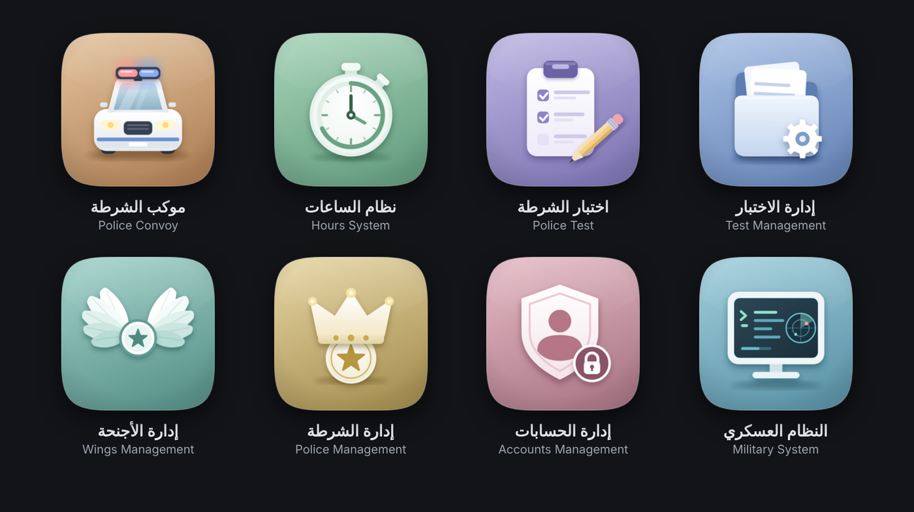
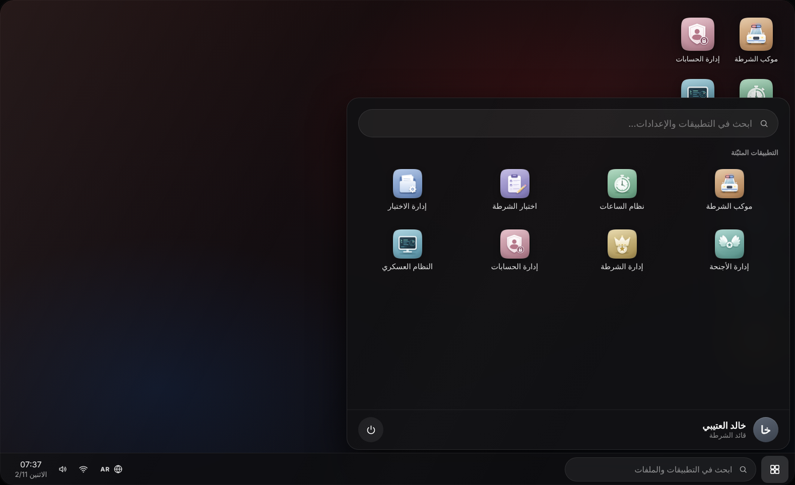
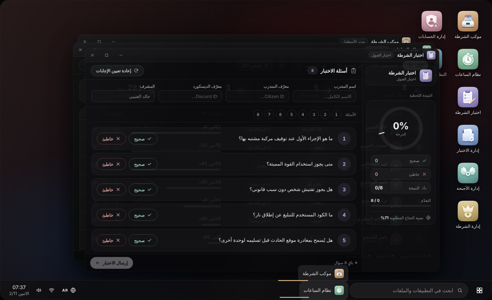
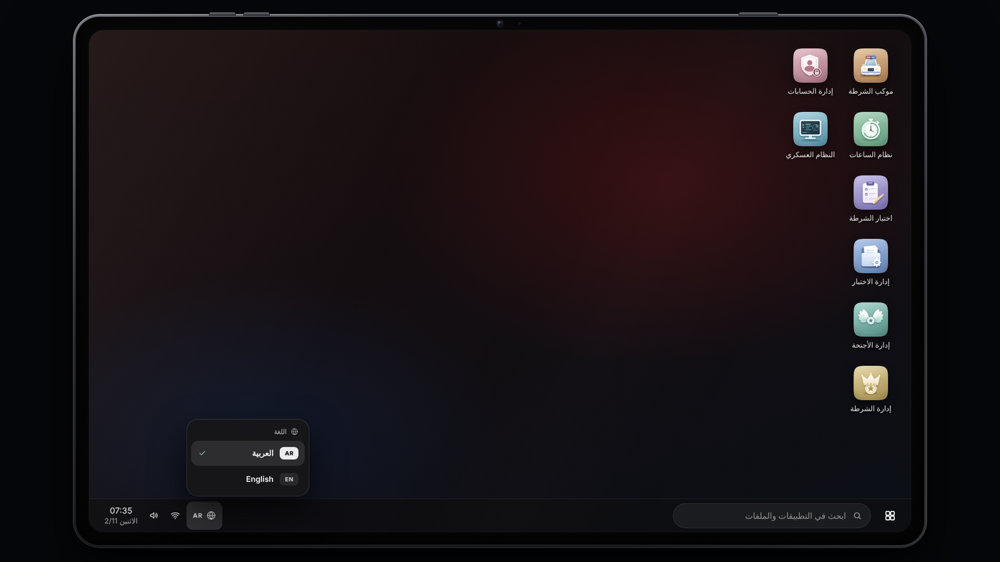
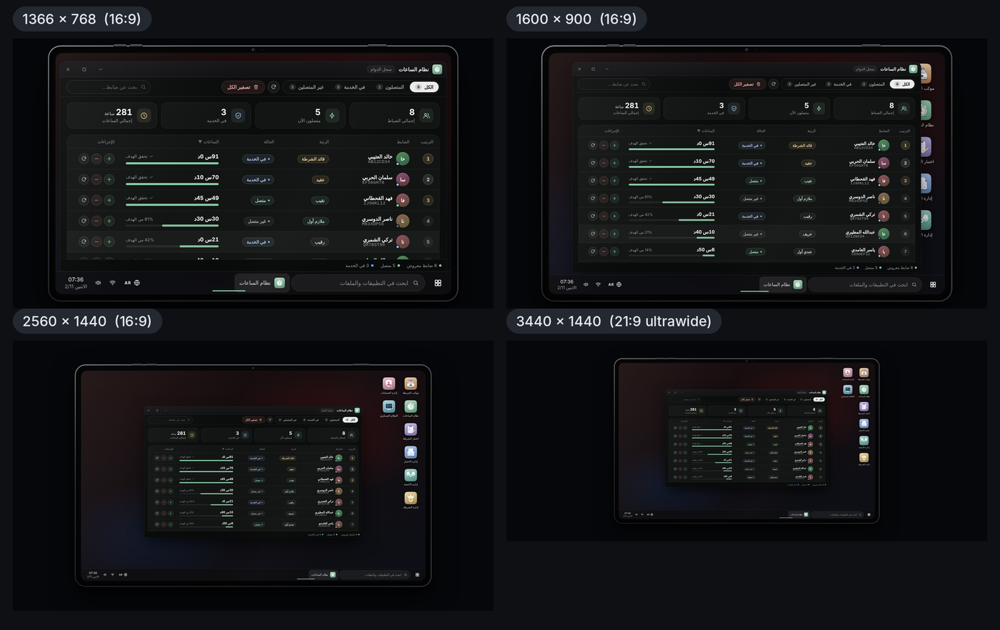

# التابلت وسطح المكتب

## كيف يُفتح التابلت؟

| الطريقة | ماذا يحدث |
|---|---|
| آيتم `tablet` | تُشغَّل أنيميشن التابلت نحو ثانية ونصف ثم تظهر شاشة الدخول |
| بوت الأجنحة | الخيار «فتح نظام الشرطة» (بدون آيتم) |
| الأمر `/policetest` | للمدرّبين المعتمدين: يفتح التابلت ثم يفتح «اختبار الشرطة» مرة واحدة بعد الدخول |
| الأمر `/createpolicetest` | لمن رتبته `TestSystem.MinGradeToManage` فما فوق: يفتح «إدارة الاختبار» بعد الدخول |

يفتح التابلت لمن يحمل وظيفة الشرطة (`Config.PoliceJob`) أو إحدى الوظائف الإضافية في `Config.ExtraJobNames`. غيرهم يرون «أنت لست ضابط شرطة!».


**كل فتح للتابلت جلسة نظيفة.** لا يُفتح أي تطبيق تلقائيًا، وإغلاق التابلت يغلق كل النوافذ ويمسح ما لم يُرسَل بعد (مثل إجابات اختبار قيد الحل). الاستثناء الوحيد هو الأمران `/policetest` و`/createpolicetest` اللذان يفتحان تطبيقًا واحدًا بعد الدخول.


## شاشة تسجيل الدخول

اكتب **الرقم الوظيفي** وكلمة المرور ثم «دخول إلى النظام». زر العين يُظهر كلمة المرور. الحسابات يُنشئها الأدمن (انظر [أول تشغيل](../getting-started/first-run.md)).

| الرسالة | سببها |
|---|---|
| الرقم الوظيفي أو كلمة المرور غير صحيحة | رقم غير موجود أو كلمة مرور خاطئة (الرسالة نفسها للحالتين عمدًا) |
| الحساب معطل | كلمة المرور صحيحة لكن الحساب مُعطَّل من إدارة الحسابات |
| محاولات كثيرة، حاول لاحقاً | تجاوز اللاعب 5 محاولات، أو تجاوز الرقم الوظيفي 10 محاولات، خلال 300 ثانية |
| أنت لست ضابط شرطة | الشخصية الحالية لا تحمل وظيفة الشرطة |

على شاشة الدخول قائمة اللغة (🌐) في أعلى الشاشة، فيختار اللاعب لغته قبل الدخول.

## سطح المكتب

* تظهر الأيقونات في عمود (أو أكثر) على جانب الشاشة، وعددها يتبع ما تسمح به صلاحياتك (الجدول أدناه).
* **انقر مرتين** على الأيقونة لفتح التطبيق، أو افتحه من قائمة «ابدأ» بنقرة واحدة.
* عدد صفوف الأيقونات يتبع ارتفاع الشاشة فلا تختفي أيقونة تحت شريط المهام.

## قائمة «ابدأ»

تعرض «التطبيقات المثبّتة» التي تراها، وبطاقة الضابط (الاسم والرتبة)، وزر الطاقة «إغلاق النظام» الذي يغلق التابلت.

## النوافذ وشريط المهام

* اسحب النافذة من شريطها العلوي لتحريكها، ولكل نافذة أزرار تصغير وتكبير وإغلاق.
* تظهر كل نافذة مفتوحة كزر في شريط المهام.
* تحتوي منطقة النظام في الشريط على زر اللغة (🌐) والساعة والتاريخ.


عناصر **البحث** في شريط المهام وأيقونتا **الشبكة** و**الصوت** شكلية: الضغط عليها يُظهر إشعارًا فقط (مثل «الميزة قيد التطوير»)، وصندوق البحث داخل قائمة «ابدأ» لا ينفّذ بحثًا حاليًا.


## إغلاق التابلت

* مفتاح **ESC** يغلق التابلت كله (وليس النافذة فقط).
* زر الطاقة «إغلاق النظام» في قائمة «ابدأ».
* يُغلق تلقائيًا إذا فقد اللاعب وظيفة الشرطة أثناء فتحه.

عند الإغلاق تتوقف أنيميشن التابلت وتعود حركة اللاعب.

## التطبيقات ومن يراها

| التطبيق | الوصف تحت الاسم | يظهر لـ |
|---|---|---|
| [موكب الشرطة](convoy.md) | مدير الأسطول | كل من سجّل الدخول |
| [نظام الساعات](hours.md) | سجل الدوام | كل من سجّل الدخول |
| [اختبار الشرطة](police-test.md) | اختبار القبول | المدرّب المعتمد، أو من يملك `submit_results` أو `manage_tests` |
| [إدارة الاختبار](test-management.md) | لوحة المدرّب | من يملك `manage_tests` |
| [إدارة الأجنحة](wings.md) | فرق العمل | من يملك `manage_wings` أو `manage_wing_members` أو `manage_wing_managers`، أو هو مسؤول عن جناح |
| [إدارة الشرطة](boss.md) | الموارد البشرية | من رتبته `BossMenu.MinGradeForBoss` فما فوق، أو يملك `boss_access` |
| [إدارة الحسابات](accounts.md) | التحكم بالوصول | من رتبته `BossMenu.MinGradeForBoss` فما فوق، أو يملك `system_admin` |
| [النظام العسكري](mdt.md) | محطة العمليات | من يملك `access_system` |


من يملك رتبة `Config.AdminGrade` فما فوق يملك كل الصلاحيات تلقائيًا، فيرى كل التطبيقات.


## اللغة

زر 🌐 (في شريط المهام وفي شاشة الدخول) يفتح قائمة اللغات. اختيار لغة يغيّر **النظام والتطبيقات والإشعارات وقوائم qb-menu وخيارات qb-target فورًا**، ويُحفظ اختيار اللاعب على جهازه. التفاصيل في [اللغات](../configuration/languages.md).

## الدقّات والأحجام

الجهاز بنسبة 16:10 يتوسّط الشاشة ويتكيّف تلقائيًا مع الدقات من 1024×768 حتى 4K والشاشات العريضة، وبالاتجاهين RTL وLTR.
