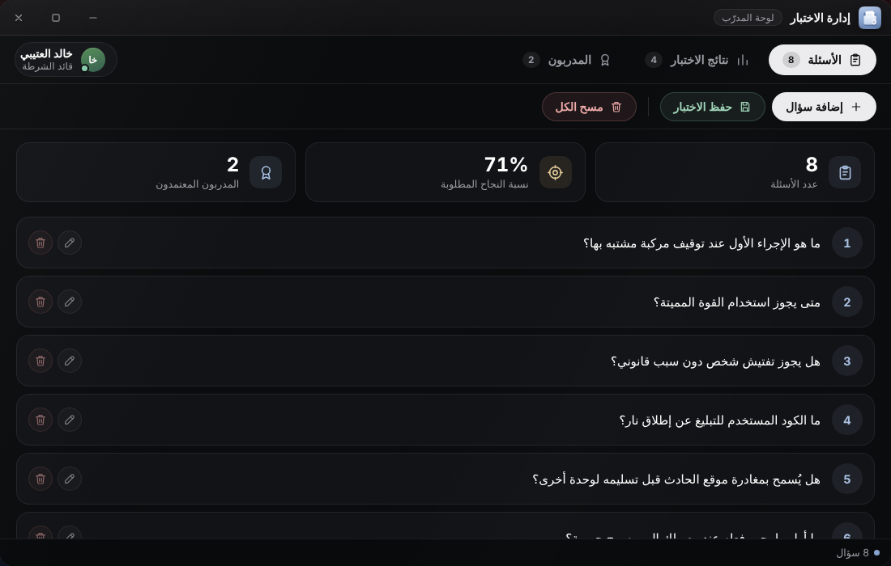
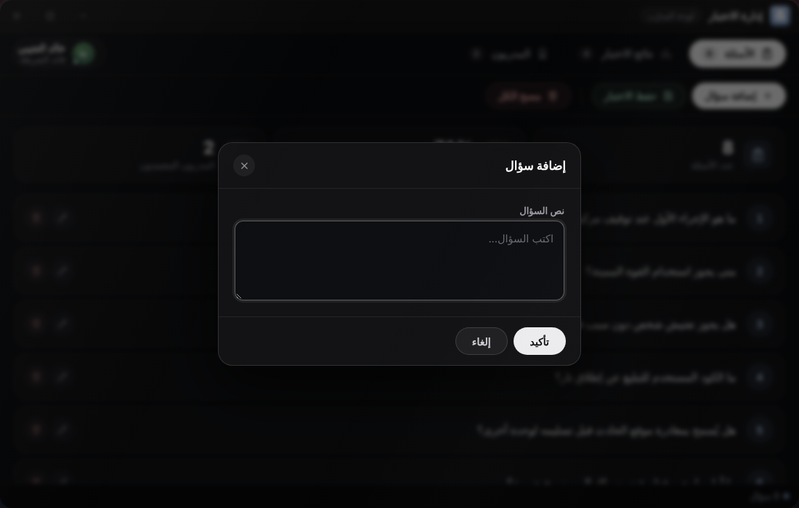
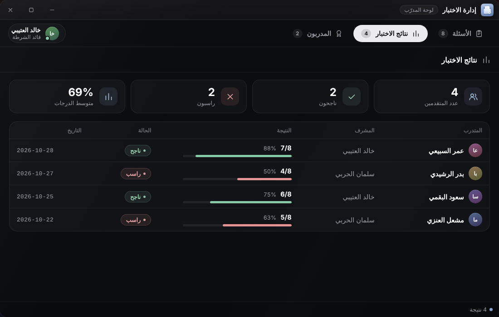
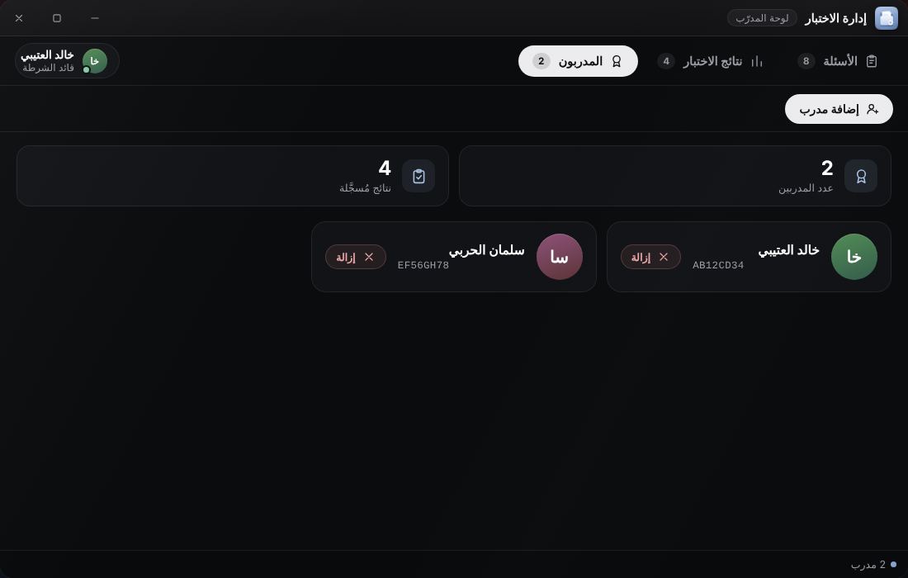

# إدارة الاختبار

تطبيق **إدارة الاختبار** (لوحة المدرّب) لمن يُعدّ أسئلة اختبار القبول ويعيّن المدرّبين. يظهر لمن يملك الصلاحية `manage_tests`، ويفتحه الأمر `/createpolicetest` لمن رتبته `TestSystem.MinGradeToManage` فما فوق.

له ثلاثة تبويبات: **الأسئلة** و**نتائج الاختبار** و**المدربون**، وعلى كل تبويب عدّاد.

## الأسئلة

| الزر | وظيفته |
|---|---|
| «إضافة سؤال» | تفتح نافذة «نص السؤال» لكتابة سؤال جديد |
| أيقونة التعديل والحذف على كل سؤال | تعديل نص السؤال أو حذفه |
| «مسح الكل» | يحذف كل الأسئلة بعد تأكيد |
| «حفظ الاختبار» | يرسل الأسئلة إلى السيرفر ويحفظها |


الإضافة والتعديل والحذف والمسح تجري **على شاشتك فقط** إلى أن تضغط **«حفظ الاختبار»**. إغلاق التابلت قبل الحفظ يضيّع التعديلات.


* الحفظ **يستبدل** قائمة الأسئلة المحفوظة بالكامل بما في الشاشة.
* الحد الأقصى **200 سؤال**، ولكل سؤال **500 حرف** كحد أقصى. الأسئلة الفارغة تُتجاهل.
* لا يمكن حفظ اختبار فارغ (يظهر «أضف أسئلة أولاً»).
* يراها المدرّب في تطبيق [اختبار الشرطة](police-test.md) بالترتيب نفسه.
* تُخزَّن في جدول `police_test_questions`، ونصوص الأسئلة **لا تُترجم** لأنها بيانات تكتبها أنت.

## نتائج الاختبار

جدول فيه: المتدرب والمشرف والنتيجة (مع شريط) والحالة (ناجح أو راسب) والتاريخ.


هذا التبويب يعرض **النتائج التي أُرسلت من جهازك أثناء جلسة التابلت الحالية فقط**، ولا يحمّل السجل من قاعدة البيانات. السجل الدائم لكل النتائج هو جدول `police_test_results` ورسائل ويبهوك **Results**. للقبول والرفض استعمل `/accepttest` و`/rejecttest` كما في [اختبار الشرطة](police-test.md).


## المدربون

* «إضافة مدرب»: أدخل **معرّف المواطن (Citizen ID)** للمدرّب. يجب أن يكون موجودًا في قاعدة البيانات وغير مضاف مسبقًا («مدرب بالفعل»)، فيصله إشعار «🎖 تم تعيينك مدرباً للاختبارات!» إن كان متصلًا.
* لكل مدرب بطاقة فيها اسمه ومعرّفه وزر لإزالته.
* المدرّبون محفوظون في جدول `police_test_trainers`.


من يملك `submit_results` أو يُعدّ مدير اختبار يستطيع إرسال النتائج دون أن يكون في قائمة المدرّبين.


## الصلاحيات المتعلقة

| الصلاحية | تأثيرها |
|---|---|
| `manage_tests` | ظهور التطبيق، وحفظ الأسئلة، وإضافة المدرّبين وإزالتهم، وقبول النتائج ورفضها |
| `submit_results` | ظهور «اختبار الشرطة» وإرسال النتائج |
| `create_questions` و`manage_trainers` و`approve_results` | معرّفة في القائمة لكن الكود لا يفحصها حاليًا، انظر [الصلاحيات](../configuration/permissions.md) |
