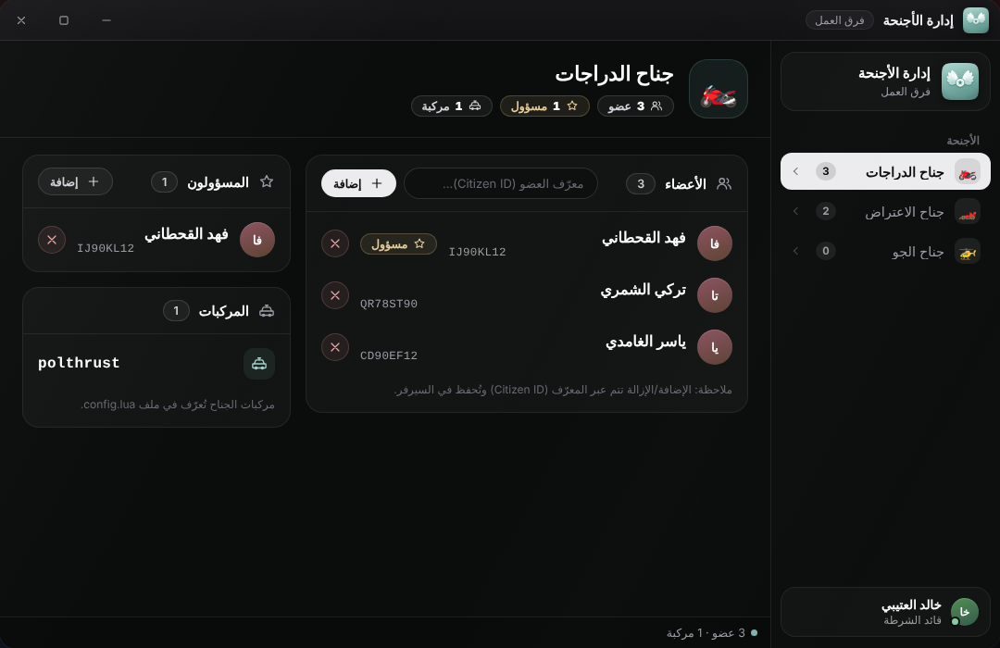

# إدارة الأجنحة

## ما هو الجناح؟

الجناح وحدة داخل الشرطة (جناح الدراجات، الاعتراض، الجو ...) لها **اسم** و**مركبات** و**نقطة إخراج** وأعضاء ومسؤولون. عضو الجناح يستطيع إخراج مركبات جناحه من [بوت الأجنحة](npcs.md).

تُعرَّف الأجنحة الثابتة في `Config.Wings` داخل `config.lua`، ويستطيع البوس إنشاء أجنحة جديدة من تطبيق [إدارة الشرطة](boss.md) دون تعديل الملفات.

## تطبيق إدارة الأجنحة

يديره من يملك `manage_wings` أو `manage_wing_members` أو `manage_wing_managers`، أو من هو مسؤول عن جناح.



* **الشريط الجانبي** يعرض الأجنحة وعدد أعضاء كل جناح.
* أعلى الصفحة بطاقة الجناح: عدد الأعضاء والمسؤولين والمركبات.
* **الأعضاء**: اكتب **معرّف العضو (Citizen ID)** واضغط «إضافة»، أو أزل عضوًا من قائمته.
* **المسؤولون**: يظهر زر «إضافة» لمن يملك `manage_wing_managers` فقط.
* **المركبات**: للعرض فقط، فمركبات الجناح تُعرَّف في `config.lua`.

### أي الأجنحة تراها؟

* ترى **كل** الأجنحة إن كانت رتبتك 10 فما فوق (الرقم ثابت داخل الواجهة)، أو تملك `manage_wings`.
* وإلا ترى الأجنحة التي أنت **مسؤول** عنها فقط، وإن حاولت فتح غيرها يظهر «لست مسؤولاً عن هذا الجناح».
* من لا جناح له يرى «لا تملك أجنحة لإدارتها — تواصل مع المسؤول لإسناد جناح إليك.»


الرقم 10 في عرض الأجنحة مكتوب داخل `html/script.js` وليس مرتبطًا بالإعداد `Config.MinGradeForManager`. السيرفر يستعمل `MinGradeForManager` في فحوصه، فإن غيّرته فقد تحتاج تعديل الرقم في الواجهة أيضًا.


## قواعد السيرفر

| العملية | من يستطيعها |
|---|---|
| إضافة عضو أو إزالته | من رتبته `MinGradeForManager` فما فوق، أو يملك `manage_wings` أو `manage_wing_members`، أو مسؤول عن ذلك الجناح |
| إضافة مسؤول جناح أو إزالته (من هذا التطبيق) | من يملك `manage_wing_managers`، أو رتبته `MinGradeForManager` فما فوق |

* **المستهدف يجب أن يكون ضابطًا** (متصلًا أو غير متصل) وإلا يظهر «هذا الشخص ليس ضابطاً».
* تكرار الإضافة يظهر «الشخص يملك هذا الجناح مسبقاً» (للأعضاء) أو «هذا الشخص مسؤول بالفعل» (للمسؤولين).
* **المسؤول يُضاف عضوًا تلقائيًا** إن لم يكن عضوًا.
* يصل المستهدف إشعار («تم منحك جناح: …» أو «تم سحب جناح: …») إن كان متصلًا.
* فصل الضابط من [إدارة الشرطة](boss.md) يسحب كل أجنحته وإشرافه عليها.

## تعريف الأجنحة في config.lua


```lua
Config.Wings = {
    ['atv'] = {
        label      = 'جناح الدراجات',
        icon       = 'motorcycle',
        vehicles   = {{ spawn = 'polthrust', label = 'دراجة نارية' }},
        spawnPoint = vector4(53.3359, -422.4056, 38.3669, 249.7106),
    },
}
```


| المفتاح | المعنى |
|---|---|
| `['atv']` | معرّف الجناح (يُخزَّن في قاعدة البيانات)، فلا تغيّره بعد أن يحصل عليه أعضاء |
| `label` | الاسم الظاهر |
| `vehicles` | قائمة `{ spawn = 'اسم_الموديل', label = 'الاسم الظاهر' }` |
| `spawnPoint` | مكان خروج المركبة `vector4(x, y, z, heading)` (اختياري) |
| `icon` | غير مستعمل للأجنحة المكتوبة في `config.lua`: تظهر بالرمز 🏅 |


إن لم تضع `spawnPoint` تظهر مركبة الجناح **بجانب اللاعب** ويُنقل اللاعب إلى مقعد السائق.


الأجنحة التي ينشئها البوس تُحفظ في جدول `police_custom_wings` وتحمل الرمز الذي اختاره، وتُحمَّل عند كل تشغيل.
